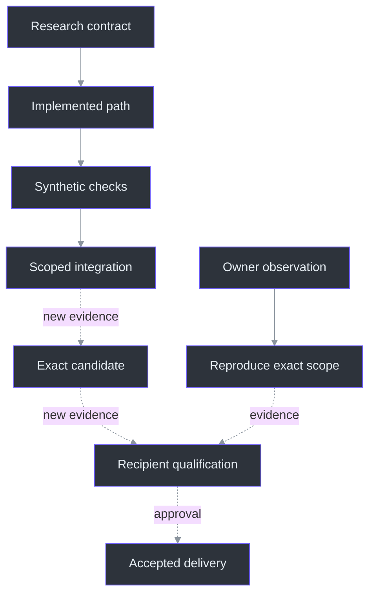
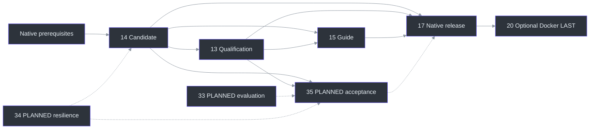
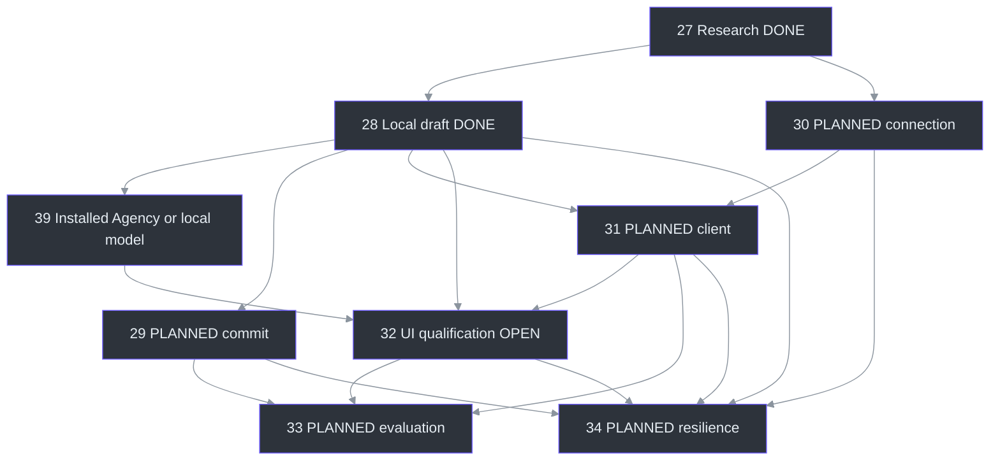

# 21. Evidence and Roadmap

## Why evidence needs its own architecture

A living engineering book must distinguish **what exists**, **what was observed**, and **what is justified for users**. Phantom Fudge has an implemented native preview and recorded local results; it does not have a qualified public release or an implemented Azure answer feature. A plausible design, passing synthetic test, and owner acceptance answer different questions. Combining them into one “done” badge would discard the most important information. (docs\IMPLEMENTATION-STATUS.md:3-140, current scope; docs\TODO-CONVENTIONS.md:58-70, evidence classes.)

This chapter reads the frozen application source and current public evidence summaries. It does not rerun application tests, inspect private capture receipts, requalify a package, or perform cloud/audio operations. “Recorded result” below means the cited repository reports that observation, not that this documentation session independently repeated it. The qualification contract explicitly rejects substituting local previews, API return codes, or missing recordings for recipient evidence. (TODO\13_COMPATIBILITY_QUALIFICATION.todo:24-35, acceptance and evidence.)

The engineering unit of assurance is therefore a **bounded claim**: a behavior, an exact subject, an environment, a procedure, an observation, and its limits. The repository's result template already asks for source identity, package hash, operating system, GPU, sharing backend, positive controls, frame coverage, and reviewer approval. A result without those boundaries may help investigation, but should not silently widen support. (docs\QUALIFICATION.md:142-168, result record.)

## The evidence ladder: stronger claims require additional proof

The ladder is not permission to infer the next rung. Each transition requires evidence appropriate to its scope; an owner report remains a separate observation until reproduced under a known configuration. (docs\TODO-CONVENTIONS.md:64-70, noninterchangeable evidence; docs\CURSOR-AND-THEMES.md:38-55, unresolved owner report.)



| Evidence class | What it establishes | What it cannot establish alone |
| --- | --- | --- |
| Primary research | A documented API capability or proposed design | This account's permissions or a working integration |
| Source inspection | An implemented branch and its invariants | Successful execution on a user's machine |
| Synthetic checks | Behavior under controlled inputs and injected failures | Real microphone quality or recorder compatibility |
| Real engine, synthetic PCM | Model/protocol integration without live capture | Real-speaker, room, echo, or meeting accuracy |
| Scoped hardware observation | A particular device path actually worked | Other devices, capture backends, or environments |
| Exact-package qualification | Observed behavior for an identified candidate/configuration | All future versions or unsampled frames |
| Owner/release acceptance | Deliberate approval of delivered scope | A universal privacy or invisibility guarantee |

These distinctions are instantiated by the native-runtime evidence, dual-source integration limits, qualification procedure, and final acceptance gates. (TODO\22_NATIVE_PYTHON_RUNTIME.todo:30-38, native results; TODO\26_MICROPHONE_AND_COMPUTER.todo:34-41, synthetic integration; docs\QUALIFICATION.md:79-107, capture procedure; TODO\17_RELEASE_ACCEPTANCE.todo:13-29, acceptance.)

### Configuration is not observation of captured pixels

`WindowProtection.Configure` checks Windows/DWM conditions, sets window styles and affinity, inspects available readback, and flushes composition. None of those calls observes another participant's screen. `ShowProtected` configures before showing and reports an unqualified-preview status. This is implemented failure-prevention logic, not recipient certification. (src\PhantomFudge.App\Native\WindowProtection.cs:19-48, `Configure`; src\PhantomFudge.App\MainWindow.xaml.cs:98-126, `ShowProtected`.)

Similarly, `CursorPolicy.SetArrow` sets the local standard cursor. It does not choose the recorder's cursor-capture option. The owner's reported disappearing shared cursor is credible as a reported symptom, while its exact product/backend reproduction remains missing. Local Arrow and nonactivation evidence cannot close that gap. (src\PhantomFudge.App\Native\CursorPolicy.cs:8-24, `SetArrow`; docs\CURSOR-AND-THEMES.md:40-54, recorder boundary.)

## What the current evidence actually says

The earlier dual-source update records **41 Core tests, 46 native synthetic groups, 71 backend tests, and four manager-upgrade guards**. The subsequent local-question slice adds96Core cases, bringing that historical Core run to137, and repeats the46native groups with GUID identity assertions. Python's71cases remain earlier evidence, not a fresh run for the C#-only change. These are distinct scopes, not one interchangeable total. (docs\IMPLEMENTATION-STATUS.md:136-144, earlier dual-source evidence; [local-question receipt](../../TODO/28_QUESTION_DRAFTS.todo).)

The recorded real Python recognizer processed generated dual-source PCM with Computer/Mic partial counts of **11/8** and three finals each. The actual C# v2-to-Python path produced **13/10** partials and two finals each, with expected phrases and tail drain. “Real” describes the engine and transport; the input was still synthetic. No physical microphone, device-permission, echo, or OS-indicator qualification follows. (docs\IMPLEMENTATION-STATUS.md:136-140, integration results.)

Two earlier observations have different boundaries:

- An explicitly approved playback-loopback check recorded 11 partials, three finals, 37 nonzero-meter updates, expected phrase matching, and zero faults. That establishes one actual render-endpoint path, not the later dual-input hardware matrix. (docs\IMPLEMENTATION-STATUS.md:238-250, playback evidence.)
- A cropped GDI proof reported a 100,000-differing-pixel positive control and 16 protected samples matching the underlying baseline. That is specific BitBlt evidence, not continuous startup-frame coverage or Teams/Zoom/Meet/OBS qualification. (docs\IMPLEMENTATION-STATUS.md:239-246, synthetic capture evidence.)

The public speech benchmark covers **32 synthetic cases, 164.070 seconds, and 292 normalized reference words**, with two serial warm passes. Its recorded results are:

| Engine | WER | Median warm decode |
| --- | ---: | ---: |
| SAPI en-US dictation | 45.89% | 10.139 s |
| Vosk small-en-us-0.15 | 8.22% | 41.754 s |
| Whisper base.en, CPU int8 | 4.79% | 25.745 s |

Those values are present in the public receipt, not extrapolated from model names. WER is normalized edit count divided by reference words, not a general accuracy percentage. File RTF is throughput, not live latency. Two paced Vosk first partials near 0.96 seconds and finals near 3.807 seconds are measured **from stream start**, not end-of-speech lag. Vosk was then the streaming implementation; the October 9 hybrid adoption is measured separately below. (tools\SpeechBench\results\synthetic-20261008.json:13-22, run metadata; tools\SpeechBench\results\synthetic-20261008.json:65-173, `summary`; docs\SPEECH-BENCHMARK.md:66-123, metrics and timing; TODO\23_SPEECH_ENGINE_BENCHMARKS.todo:31-35, disposition.)

## October 9 corrections: fresh evidence, bounded claims

The new local implementation expands the requested window to 1240 x 1520 clamped to monitor work
area, removes outer main-panel scrolling, adds exact white/black reading text and makes answers
share background transparency. Fifteen synthetic WPF image fixtures cover the new appearance;
none records a meeting or establishes recorder compatibility
(`src/PhantomFudge.Core/WorkspaceLayout.cs:8-42`;
`src/PhantomFudge.App/MainWindow.Layout.cs:58-107`).

The paced synthetic speech study reports Vosk WER 12.04% versus hybrid small.en technical-final
WER 4.40%, CER 6.37% versus 0.263%, and final median/p95 2.736/3.017 seconds. This is a different
corpus from October 8; raw compound-word errors, homophones and failed policies remain preserved.
Service 104 and benchmark 18 tests are recorded, with no actual microphone qualification
(`tools/SpeechBench/results/quality-validation-20261009.json:1-40`;
[quality record](../QUALITY-UPDATE.md)).

Final model selection uses the owner's exact intended and reported ASR text: the H batch produced
three prepared GPT-5.6 Sol Fast / low complete answers in 4066/4176/2992 ms. All three C# answers
compiled and passed 33 full-range checks. Earlier E used different wording; F wrong-problem/follow-up
and G overflow failures remain failures. Forty-eight client submissions were counted across the
correction study. Cold preparation around 20–31 seconds remains outside the five-second result
(`tools/AgencyProbe/results/latency-suite-20261009-h-exact-fast.json:1-56`;
`tools/AgencyProbe/results/latency-suite-20261009-h-quality.json:184-186`).

Default diagnostics now provide bounded metadata rather than retroactive claims about the old
interaction. Text is an explicit local opt-in and export strips it by default; raw audio, notes
and tokens remain excluded (`src/PhantomFudge.Core/Diagnostics/LocalDiagnostics.cs:18-24,40-69`;
`scripts/Export-Diagnostics.ps1:14-80`).

## A preview artifact is an identity, not a release claim

The historical installed-provider bundle before the quality correction was:

```text
artifacts\phantom-fudge-0.1.0-preview-win-x64-20261008-235421.zip
Size: 76,252,854 bytes
Contents: 489 files
Recorded SHA-256:
88D98E7CAFA56B067A521571778D0F661A879DDCBF5EBBE9D412987D2BFA5A69
```

The new archive was hashed and its exact executable exercised with the synthetic fixture.
Question checks include immutable/no-auto-send behavior, source/session isolation, editing without
audio cancellation, multiline fidelity and minimum layout, with no real recording/model call.
The first source attempt's unexplained foreground assertion failure is retained; later source and
package passes do not establish universal activation or recipient behavior. Earlier145231/123245/
035959bundles are historical, not alternative qualification for183107.
([Current implementation receipt](../IMPLEMENTATION-STATUS.md);
[packaging evidence](../../TODO/14_PACKAGING_RELEASE.todo).)

The publication script creates a timestamped self-contained x64 preview, refuses overwrite, copies selected documentation/scripts/service source, archives the result, and prints its hash as a **local unqualified preview**. Running that script would not satisfy clean-machine, signing, recipient, or release gates. The latest package was generated for the implementation milestone, not as proof of release qualification. (scripts\Publish-Preview.ps1:10-52, publication flow; TODO\14_PACKAGING_RELEASE.todo:13-30, remaining acceptance.)

## What still needs qualification

**Recipient pixels:** the required meeting/OBS candidates remain `NOT_TESTED`. Record product/version, exact sharing source and backend, local visibility, remote live view, applicable recording, positive controls, and transitions. A window/tab result cannot justify whole-screen support; a missing licensed recording capability is not a pass. A black rectangle can fail the intended experience even without readable text. (docs\QUALIFICATION.md:3-7, status; docs\QUALIFICATION.md:28-64, matrix and artifact criteria; docs\QUALIFICATION.md:79-107, procedure.)

**Cursor:** reproduce the owner's report in the actual sharing mode and record hover/click/drag/type, foreground changes, and recipient cursor behavior independently. Do not substitute a fake cursor, recorder modification, or the local value `MA_NOACTIVATE=3` for that observation. (TODO\24_CURSOR_AND_FOCUS.todo:14-26, open gates; docs\QUALIFICATION.md:127-137, C15.)

**Hardware and usability:** microphone access/denial, selected-device loss, echo, privacy indicators, headsets, alternative GPU/display/DPI/HDR combinations, startup transitions, accessibility, and long-session behavior remain scoped work. The code selects render versus capture endpoints explicitly; source inspection proves that branch exists, not that every physical configuration works. Owner readability/focus approval remains separate from automated success. (src\PhantomFudge.App\Audio\WasapiInput.cs:20-74, selection and `Direction`; TODO\26_MICROPHONE_AND_COMPUTER.todo:34-41, hardware gaps; docs\QUALIFICATION.md:66-77, environments; docs\IMPLEMENTATION-STATUS.md:268-277, remaining work.)

The owner handles permission and recipient rehearsal externally; those preferences removed repeated runtime confirmations. They are not an engineering pass, and this roadmap does not reintroduce those dialogs. (docs\PREVIEW-GUIDE.md:64-69, interaction contract; TODO\16_DEVELOPMENT_LEDGER.todo:63-65, decision record.)

## Roadmap: statuses describe scope, dependencies describe order

The current index covers workstreams **01–43**; documentation work adds an ongoing maintenance obligation without changing the implemented-versus-planned application boundary:

| IDs | Current disposition |
| --- | --- |
| 01–12 | 02 research is DONE; 11 accessibility is NOT_STARTED; the remaining product/core workstreams are IN_PROGRESS. |
| 13–18 | 13 qualification, 17 acceptance, and optional 18 future scope are NOT_STARTED; 14 packaging, 15 guide, and 16 ledger are IN_PROGRESS. |
| 19–26 | 22 native runtime and 23 benchmark are DONE; 20 Docker is NOT_STARTED; 19, 21, and 24–26 remain IN_PROGRESS. |
| 27 | DONE for research/design only. |
| 28 | DONE for local selected/typed drafts and immutable snapshots; provider submission is supplied separately by39. |
| 29–35 | NOT_STARTED: commit, approved Azure connection, real client/UI, evaluation, resilience, and answer acceptance. |
| 36–37 | NOT_STARTED optional cloud-ASR and conditional broker extensions. |
| 38 | DONE for the initial illustrated book and public journal; workflow06 continues maintenance with later changes. |
| 39 | DONE for installed Agency/local-model adapters; one Agency synthetic request and local/package checks passed with bounded evidence. |
| 40–43 | Local quality-correction scope: readable workspace, accurate local finals, direct prepared answers and diagnostics. Current completion/evidence is in the TODO index; broad UX/hardware/latency qualification is not closed. |

“DONE” is scoped: a local Ask snapshot does not mean cloud submission or answers exist. `NOT_STARTED` does not automatically mean `BLOCKED`; the latter requires a concrete attempted-work blocker and needed action. Stable numbers are not execution order. (TODO\00_INDEX.todo:49-58, statuses; docs\TODO-CONVENTIONS.md:40-56, dependency semantics.)

### Candidate, qualification, and release



The diagram abbreviates native prerequisites, not their completion requirements. Packaging **14 precedes qualification 13**; the current expanded release graph also includes planned answer client/UI/resilience work. Final acceptance 17 requires 13, 14, 15, and 35. Docker **20 is LAST, optional, and depends on 17**—never a prerequisite for ordinary transcription or native release. Recipe files do not prove a container ran. (TODO\00_INDEX.todo:119-158, dependency map; TODO\14_PACKAGING_RELEASE.todo:3-5, prerequisites; TODO\20_DOCKER_LOCAL_SERVICE.todo:3-10, final-stage contract; TODO\20_DOCKER_LOCAL_SERVICE.todo:29-36, execution limits.)

### Installed answers exist; commit, Azure and qualification remain open



The local selected/typed draft and immutable snapshot are implemented. Continue with source-specific
start/commit boundaries and approved cloud connection, not an automatic deployment. The target remains
local ASR and direct C# streamed text in the same protected UI. Azure identity/resource/geography approvals, actual model availability, and latency measurements remain future gates. Optional 36 depends on 27 and 33; conditional 37 depends on 27 and 30, neither silently becoming mandatory. (TODO\00_INDEX.todo:135-148, answer dependencies; TODO\27_AI_ANSWER_RESEARCH.todo:13-32, research-only scope; docs\AI-ANSWER-ARCHITECTURE.md:671-753, delivery and unresolved decisions.)

## Worked review algorithm: promote claims, not enthusiasm

The following is explanatory pseudocode for reviewing evidence, not an implemented tool or a test executed here. Its checks derive from the exact-candidate and positive-control requirements. (docs\QUALIFICATION.md:79-107, procedure; TODO\14_PACKAGING_RELEASE.todo:22-30, candidate freeze.)

```python
def assess_support_claim(claim, evidence):
    matching = [e for e in evidence
                if e.artifact_hash == claim.artifact_hash
                and e.configuration == claim.configuration]
    if not matching:
        return "NOT_TESTED"
    if any(e.observed_readable_content for e in matching):
        return "FAIL_CONTENT_LEAK"
    if any(e.observed_unacceptable_artifact for e in matching):
        return "FAIL_ARTIFACT"
    if not has_required_controls_and_recipient_frames(matching):
        return "INSUFFICIENT_EVIDENCE"  # review result, not a matrix status
    return "SCOPED_PASS_CANDIDATE"      # still needs review and acceptance
```

For example, a claim that the `145231` package supports Teams desktop sharing cannot be promoted using an older cropped GDI result. Both artifact and capture scope differ. Likewise, an owner's rehearsal preference cannot replace the missing recipient record. Retain failed and unavailable cases; changing a binary or backend makes prior results historical rather than transferable. (docs\QUALIFICATION.md:24-26, version changes; docs\QUALIFICATION.md:166-168, exact artifact; docs\IMPLEMENTATION-STATUS.md:146-152, historical dual-source package.)

## Keeping the book honest as the project changes

Reviewing the book exposed historical wording that no longer matched the implementation. The summary now describes Computer/Microphone/Both and labels its initial-preview evidence historical; workstream17 distinguishes the existing preview from unstarted final acceptance; Workstream13 follows the current C01-C19 scenario set. These corrections preserve the earlier journey without erasing implemented work or promoting a local package to a qualified release. (docs\IMPLEMENTATION-STATUS.md:220-229, corrected summary and historical heading; TODO\17_RELEASE_ACCEPTANCE.todo:31-37, final acceptance scope; TODO\14_PACKAGING_RELEASE.todo:45-57, local artifacts; TODO\13_COMPATIBILITY_QUALIFICATION.todo:18-21, current scenario list; docs\QUALIFICATION.md:127-137, added scenarios.)

**Current documentation coordination:** workstream **38** is **DONE for the initial local edition**. Its receipt records the generated HTML/PDF, reviewed illustrations and freshness result. Workflow **06**, `06_LIVING_DOCUMENTATION.todo`, is **DONE as a procedure definition**, with ongoing execution **IN_PROGRESS**: future feature changes still need matching book updates. This is documentation completion, not application release acceptance. The documentation update did not replace the current preview ZIP. (TODO\38_LIVING_DOCUMENTATION.todo:3-22, status and tasks; TODO\WORKFLOWS\06_LIVING_DOCUMENTATION.todo:3-11, definition/execution distinction; docs\IMPLEMENTATION-STATUS.md:286-292, documentation edition boundary.)

The public journal now supplies the narrative counterpart to the operational ledger. Future behavior changes require corresponding chapter, citation, diagram, image, and journal maintenance. Mechanical freshness detects drift in recorded inputs, but cannot prove semantic correctness or discover every uncited feature; human source review remains necessary. This extends the evidence discipline instead of relaxing application qualification. (JOURNAL.md:8-16, journal scope; docs\DOCUMENTATION-MAINTENANCE.md:12-27, completion requirements; docs\DOCUMENTATION-MAINTENANCE.md:69-81, freshness limitations; TODO\00_INDEX.todo:193-201, documentation definition of done.)

## Exercises and references

1. Classify the dual-source PCM result, owner cursor report, and Azure latency target. For each, write one supported claim and one prohibited inference. (docs\IMPLEMENTATION-STATUS.md:136-140; docs\CURSOR-AND-THEMES.md:40-54; docs\AI-ANSWER-EVALUATION.md:45-62.)
2. Given a rebuilt package with unchanged UI, identify which previous qualification claims must become historical and which observations remain useful diagnostics. (docs\QUALIFICATION.md:24-26, version semantics.)
3. Trace why completing optional Docker or cloud-ASR work cannot close native release 17. (TODO\00_INDEX.todo:141-148, release dependencies.)

Continue with the [implementation evidence](../../docs/IMPLEMENTATION-STATUS.md), [qualification matrix](../../docs/QUALIFICATION.md), [TODO index](../../TODO/00_INDEX.todo), [ledger](../../TODO/16_DEVELOPMENT_LEDGER.todo), [public journal](../../JOURNAL.md), and [maintenance contract](../../docs/DOCUMENTATION-MAINTENANCE.md). The [benchmark](../../docs/SPEECH-BENCHMARK.md) and [answer architecture](../../docs/AI-ANSWER-ARCHITECTURE.md) provide detailed measured-versus-planned boundaries.
