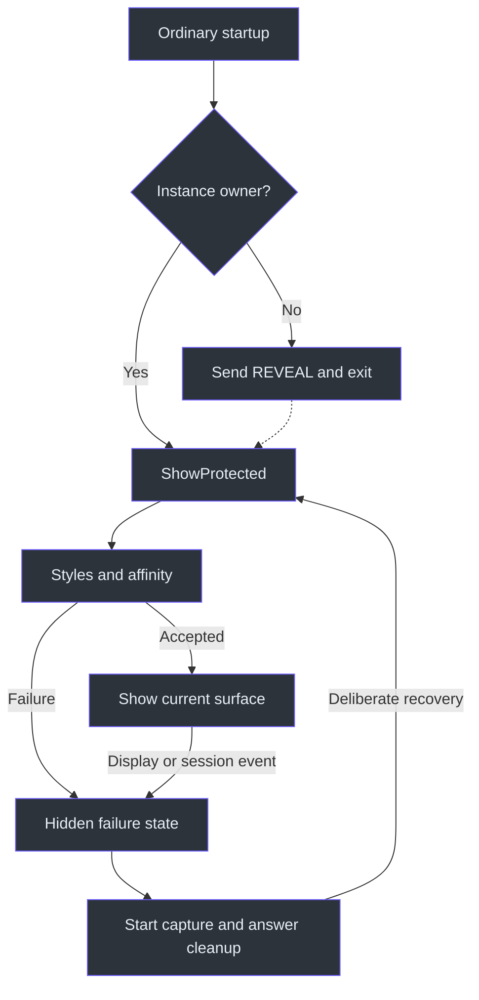
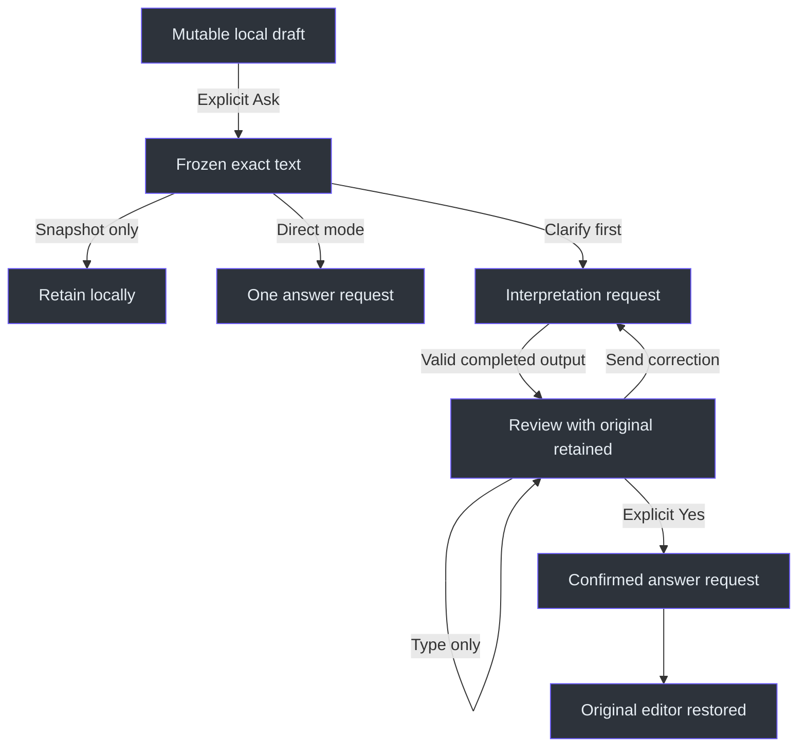

# Desktop source walkthrough

## Why the desktop needs separate state boundaries

The difficult problem is not displaying text. It is preventing one action from accidentally authorizing another: revealing is not capture certification, choosing **Both** is not starting audio, editing a question is not editing Notes, and receiving an interpretation is not permission to send confirmation. The implementation expresses those distinctions through separate fields, immutable snapshots and guarded event handlers—not through separate windows. The central predicate is now `PassiveWindow => presenting && !questionEditing && !KeyboardControlActive`; question typing or deliberately armed keyboard control can take focus while Notes remain read-only. (src/PhantomFudge.App/MainWindow.Questions.cs:24) (src/PhantomFudge.App/MainWindow.xaml.cs:278)

This chapter follows the desktop source. The table below records the earlier reviewed atlas snapshot,
not a new coverage receipt for the in-progress keyboard increment. The [source atlas](../source-atlas/index.html)
carries authored explanations and selected excerpts; its [reading guide](../source-atlas/README.md)
explains navigation. Core and audio dependencies have separate source groups.

### Current increment: keyboard intent without cursor manipulation

`MainWindow.Keyboard` owns activation, guarded mode transitions and best-effort previous-window
return. `KeyboardSelection` separates the current-row key from selected segments and requires
Enter review before the beginner Ctrl+Enter path. `KeyboardDevices` moves a card cursor without
selecting until Space. `AnswerFont` retains a nullable session choice ahead of the responsive
default; it does not write settings. These paths use local key routing, not global letter capture,
and do not lock/hide/warp the system pointer.
(src/PhantomFudge.App/MainWindow.Keyboard.cs:65-175,218-306;
src/PhantomFudge.App/MainWindow.KeyboardSelection.cs:10-28,110-159;
src/PhantomFudge.App/MainWindow.KeyboardDevices.cs:42-71;
src/PhantomFudge.App/MainWindow.AnswerFont.cs:9-43.)

The important lifecycle distinction is ordinary mode preservation versus explicit actions:
`:devices` refuses busy audio/answers and opens setup, which closes Q/A; `:stop` stops audio,
`:cancel` affects answers/preparation, and `:clear question` retains existing cancellation.
The [canonical guide](../KEYBOARD-CONTROLS.md) owns keys, JSON, illustrations and final runtime-fixture
evidence. The maintained atlas covers all new and changed files; diagnostic definitions alone
must still be distinguished from the actual synthetic receipts.
(src/PhantomFudge.App/MainWindow.Keyboard.cs:320-368;
src/PhantomFudge.App/MainWindow.KeyboardDiagnostics.cs:209-214.)
The compact layout now separates intended Q/A expansion from rendered visibility. Select/Search
borrow its space for transcript selection; leaving restores Q/A without its close/cancel handler.
Other compact keyboard modes and chosen size 14+ answers prioritize Q/A while retaining transcript
content. This does not change wide columns or capture/provider lifetime. The
[canonical compact-layout section](../KEYBOARD-CONTROLS.md#compact-windows-the-active-task-gets-the-reading-space)
records the size 24 / 470 × 560 motivation and final synthetic fit checks without implying owner
comfort or external foreground qualification.

`LoadKeyboardShortcut` catches invalid-data failures as well as other configuration errors.
`RefreshKeyboardEditorTarget` keeps Edit armed across submission and switches between the original
and reply only when that target is visible, enabled, focusable and editable. Async focus changes
require an already-active, visible, uncovered, protected app; they never activate it from another
application. The final synthetic checks wait a normal dispatcher turn rather than re-entering Edit.
(src/PhantomFudge.App/MainWindow.Keyboard.cs:38-51,127-139,301-306;
src/PhantomFudge.App/MainWindow.KeyboardDiagnostics.cs:170-193.)

| Reading route | Assigned files | Physical lines | Authored blocks |
| --- | ---: | ---: | ---: |
| Startup, failure notice, project declaration | 3 | 155 | 10 |
| Four native adapters | 4 | 252 | 13 |
| Application/window XAML and theme brushes | 3 | 946 | 38 |
| Main window coordinator and layout | 2 | 1,411 | 46 |
| Questions, direct selection, clarification | 3 | 669 | 23 |
| Answers and provider lifetime | 2 | 468 | 17 |
| Indicator, diagnostics and synthetic UI assertions | 8 | 1,173 | 45 |
| Audio device-card layout and paging | 1 | 160 | 6 |
| Visual cover lifecycle | 1 | 78 | 4 |
| **Total** | **27** | **5,312** | **202** |

The project declares a Windows .NET 10 WPF executable, a Core reference and NAudio 2.2.1; that declaration is not evidence of a build or device qualification. Selection/clarification increments 44/45 are source-only, and the historical `045022` ZIP excludes them. Direct Azure remains future work and Docker remains optional/last, not prerequisites of these handlers. (src/PhantomFudge.App/PhantomFudge.App.csproj:1) (TODO/00_INDEX.todo:39)

## 1. From process startup to protected reveal

`App.xaml` uses explicit shutdown and no `StartupUri`. Consequently, WPF does not automatically display a startup window before application code can configure it. `App.OnStartup` first handles exact command-line modes: explicit provider preparation, capture proof, UI smoke or documentation screenshots. Ordinary startup then constructs `SingleInstance`. A nonowner sends a six-byte `REVEAL` command and exits; the owner installs dispatcher-marshalled recovery callbacks and calls `ShowProtected`. (src/PhantomFudge.App/App.xaml:1) (src/PhantomFudge.App/App.xaml.cs:18) (src/PhantomFudge.App/App.xaml.cs:62)

Recovery is deliberately narrow. `SingleInstance` hashes the current SID to name its channel, uses a `Local` mutex and `CurrentUserOnly` pipes, and accepts no file path or arbitrary text command. Connection/write uses a five-second deadline; the server gives an established peer two seconds to supply six bytes. It compares those six bytes with `REVEAL`, not the entire remainder of a peer stream. Mutex ownership is session-local; the hashed name itself is not a secret. (src/PhantomFudge.App/Native/SingleInstance.cs:18) (src/PhantomFudge.App/Native/SingleInstance.cs:28) (src/PhantomFudge.App/Native/SingleInstance.cs:51)



The diagram's reconfiguration path is implemented by `RevealAndReset → TryReveal → ShowProtected`; initial startup failures instead reach `App.OnStartup`'s catch and shutdown. `ShowProtected` clears readiness, configures native protection, repairs placement, attaches first-use hooks/hotkeys, updates controls and only then calls `Show`. `Configure` itself does not hide the window: callers performing interaction transitions hide first. (src/PhantomFudge.App/MainWindow.xaml.cs:99) (src/PhantomFudge.App/MainWindow.xaml.cs:146) (src/PhantomFudge.App/App.xaml.cs:77)

The consequential native distinction is:

```csharp
var readback = GetWindowDisplayAffinity(handle, out var affinity);
var readbackError = readback ? 0 : Marshal.GetLastPInvokeError();
if (readback && affinity != ExcludeFromCapture)
    throw new InvalidOperationException("Capture-affinity readback contradicts the requested setting.");
```

An unavailable getter is recorded as unavailable; a successful contradictory getter aborts. Before this, Windows build 22000 and DWM composition are required, unrelated style bits are preserved, ToolWindow is added, AppWindow removed and NoActivate selected by interaction mode. Setter failure is fatal. `DwmFlush` follows, but none of these operations observes recipient pixels. “Capture protection requested” is therefore the accurate UI wording. (src/PhantomFudge.App/Native/WindowProtection.cs:19) (src/PhantomFudge.App/Native/WindowProtection.cs:30) (src/PhantomFudge.App/MainWindow.Layout.cs:36)

Detected display/session/power invalidation clears readiness, hides immediately, cancels the answer and awaits activity cleanup. Generic failure notices contain fixed messages, not note text or exception bodies. Ctrl+Alt hotkeys use `RegisterHotKey`, not a keystroke hook; collision leaves second-launch recovery available. Listener disposal cancels first and disposes its token source only after the listener finishes. (src/PhantomFudge.App/MainWindow.xaml.cs:178) (src/PhantomFudge.App/MainWindow.xaml.cs:228) (src/PhantomFudge.App/LocalFailureNotice.cs:11) (src/PhantomFudge.App/Native/WindowHotkeys.cs:13) (src/PhantomFudge.App/Native/SingleInstance.cs:79)

## 2. Resources, alpha and hit regions are behavioral code

The window is layered, topmost and initially nonactivating. `WindowChrome` supplies a 38-unit caption and six-unit resize border; the title ignores hit testing, while header actions explicitly opt into client hit testing within chrome. Without that exception, clicking an apparent button could begin a window drag. Text areas remain client regions, not custom drag handles. (src/PhantomFudge.App/MainWindow.xaml:5) (src/PhantomFudge.App/MainWindow.xaml:112) (src/PhantomFudge.App/MainWindow.xaml:135)

The background slider does **not** change whole-window opacity:

```csharp
var alpha = (byte)Math.Round(Math.Clamp(args.NewValue, 10, 100) * 255 / 100);
var background = ThemeBrushes.Color(ThemePalette.For(currentTheme).Background);
WindowSurface.Background = new SolidColorBrush(Color.FromArgb(alpha, background.R, background.G, background.B));
```

Only the root brush receives alpha. Reading controls have transparent backgrounds and opaque high-contrast foregrounds; opaque toolbar/setup surfaces remain readable. Theme changes replace frozen semantic brushes and then reapply the existing slider value. `HighContrastReading` is a separate palette role, not the ordinary muted chrome text color. (src/PhantomFudge.App/MainWindow.xaml.cs:482) (src/PhantomFudge.App/ThemeBrushes.cs:9) (src/PhantomFudge.App/MainWindow.xaml:523)

Dynamic `ControlsFocusable` connects App-level button/list/checkbox templates to interaction state. Text boxes retain WPF's `PART_ContentHost`, while custom scrollbar templates change both page commands and dimensions for horizontal orientation. Direct transcript rows intentionally differ from normal chooser rows: selection changes an outline, not the transparent fill. Null-segment separators are disabled. A transparent rendering surface is not click-through. (src/PhantomFudge.App/App.xaml:14) (src/PhantomFudge.App/App.xaml:48) (src/PhantomFudge.App/App.xaml:177) (src/PhantomFudge.App/MainWindow.xaml:77)

Placement converts native work-area pixels through `TransformFromDevice`, then fits logical bounds. At 900 units the reader becomes two columns; narrow short layouts sometimes replace transcript space with source tools or clarification replies. Each reader scrolls internally. The geometry assertions measure line-height/padding, width and containment above Notes; they do not establish accessibility or readability over every background. (src/PhantomFudge.App/MainWindow.Layout.cs:41) (src/PhantomFudge.App/MainWindow.Layout.cs:58) (src/PhantomFudge.App/MainWindow.Layout.cs:155) (src/PhantomFudge.Core/WorkspaceLayout.cs:12)

## 3. Follow a transcript click into a question

Audio setup is a separate inline workspace: measured cards wrap by source and use explicit pages
only when they do not fit. The full item collections and selected records remain intact; hiding a
card on another page does not change capture identity. Visibility, size and collection notifications
coalesce a layout refresh, while capture lifecycle guards reject page changes. See
[`LayoutDeviceCards`](../../src/PhantomFudge.App/MainWindow.AudioDeviceCards.cs) and its
[synthetic viewport/selection checks](../../src/PhantomFudge.App/MainWindow.AudioDeviceCardsDiagnostics.cs).

There are three representations for three different jobs:

| Representation | Responsibility | Important distinction |
| --- | --- | --- |
| `TranscriptBuffer` | Display/export text and unfinished labels | Not the source of question identity |
| `StructuredTranscriptStore` | Session/source/segment identity and revisions | Bounded chooser can evict old records |
| `TranscriptRow` and `QuestionDraft` | Visible history plus copied explicit selection | Selected text can survive store eviction |

These responsibilities follow `ReceiveTranscript`, `AppendFinalTranscriptRow` and `QuestionDraft.ReplaceSelection`, rather than being inferred from names. (src/PhantomFudge.App/MainWindow.xaml.cs:796) (src/PhantomFudge.App/MainWindow.TranscriptSelection.cs:13) (src/PhantomFudge.Core/QuestionDraft.cs:18)

An audio event first passes its capture GUID check. `LoopbackTranscriber` stamps events from its own session before invoking the subscriber; a stale dispatcher callback therefore cannot relabel itself as the new session. Only diagnostic rendering may supply the current GUID for an unstamped synthetic event. Accepted events update export text, structured state and then row presentation. Those updates are sequential, not a transaction across both stores; invalid data/capacity stops capture and leaves memory available for export. (src/PhantomFudge.App/Audio/LoopbackTranscriber.cs:95) (src/PhantomFudge.App/MainWindow.xaml.cs:798)

Direct row clicks toggle `IsSelected` and consume the preview event. The selection handler:

1. Rejects missing protection, file work, manually edited drafts or a clarification lock.
2. Applies additions/removals to a dictionary keyed by structured identity.
3. Orders visible selections by main-history rows followed by partial rows, not click order; copied entries outside the view are retained.
4. Calls `ReplaceSelection`, then opens Q/A, closes tools and calls `SetQuestionEditing(true)`.

That final call deliberately takes keyboard focus; direct transcript clicks are **not** passive device/chooser clicks. They do not call Freeze, StartAsync or a provider prompt. (src/PhantomFudge.App/MainWindow.TranscriptSelection.cs:85) (src/PhantomFudge.App/MainWindow.TranscriptSelection.cs:118)

`ReplaceSelection` validates a complete candidate before assigning state: one session, at most 256 distinct keys and 8192 UTF-16 code units including inserted platform newlines. It copies raw `segment.Text`, so literal `[Computer]` inside speech is not stripped or interpreted. Selected partials refresh by the same key/revision; manual edits block ASR replacement. Main rows outlive the smaller structured chooser, and appending a final scrolls only when already near the end. (src/PhantomFudge.Core/QuestionDraft.cs:18) (src/PhantomFudge.Core/QuestionDraft.cs:61) (src/PhantomFudge.App/MainWindow.TranscriptSelection.cs:22)

**Do not unify the two selection handlers by assumption.** Manual **Choose source → Use selected** is explicit replacement: it checks clarification lock and empty selection but does not contain the direct handler's `UserEdited`, `protectionReady` or `fileBusy` checks. It can deliberately replace an edited draft. Documentation must describe that difference rather than claim every path has identical guards. (src/PhantomFudge.App/MainWindow.Questions.cs:105)

Independent question typing hides, changes `questionEditing`, updates controls and reapplies protection before focus. It never calls `StopVisibleActivityAsync`; global Notes Edit does. Routing both actions through global Edit would therefore violate continuing dictation. (src/PhantomFudge.App/MainWindow.Questions.cs:158) (src/PhantomFudge.App/MainWindow.xaml.cs:253)

## 4. Original question, submitted text and reply are not interchangeable

Ordinary Ask checks reply/busy/readiness/protection/file guards, freezes the draft and displays its `ExactText`. SnapshotOnly stops there. Configured direct Ask creates an `AnswerRun`; its request contains a fresh request ID and exact text, not the entire snapshot's source provenance. The Agency direct prompt adds fixed answer-only policy but no clarification history, requesting a standalone answer without follow-up input. A policy instruction is not proof of every model's compliance. (src/PhantomFudge.App/MainWindow.Questions.cs:265) (src/PhantomFudge.App/MainWindow.Answers.cs:136) (src/PhantomFudge.Core/Answers/AnswerRun.cs:15) (src/PhantomFudge.Core/Answers/AgencyAnswerPrompt.cs:89)



Clarify first starts unchecked and its backing Boolean defaults false. Opting in only changes state; the next explicit Ask stores `clarificationOriginal` and begins an unconfirmed request. `ClarificationLocksQuestion` starts immediately, whereas `AwaitingClarificationReply` requires completed history. A cancelled/failed first interpretation can therefore leave the original locked without a reply panel; clear or mode change resets the flow rather than treating partial output as an accepted interpretation. (src/PhantomFudge.App/MainWindow.xaml:321) (src/PhantomFudge.App/MainWindow.Clarification.cs:11) (src/PhantomFudge.App/MainWindow.Clarification.cs:39)

Replies use a **new temporary draft**:

```csharp
var metadata = new AnswerClarification(IsConfirmationReply(reply), clarificationHistory);
metadata.ValidateFor(reply);
var draft = new QuestionDraft();
draft.EditText(reply);
var snapshot = draft.Freeze();
```

The original `questionDraft` remains untouched. `lastQuestionSnapshot` now records this submitted reply, even when that reply is `" yEs "`. Confirmation recognition trims and compares case-insensitively, but does not normalize `ExactText`. The Yes button refuses to discard a non-Yes written correction. Copy original still copies the original draft, not the reply. (src/PhantomFudge.App/MainWindow.Clarification.cs:85) (src/PhantomFudge.App/MainWindow.Clarification.cs:117) (src/PhantomFudge.App/MainWindow.Clarification.cs:134) (src/PhantomFudge.App/MainWindow.Questions.cs:307)

Before accepting an interpretation, `ValidateClarificationResult` checks that appending it still leaves a valid explicit Yes transaction. Core limits are four interpretations, 8192 units per text and 32768 total context units. No silent history trimming occurs. Acceptance additionally matches both current run reference and clarification request ID; confirmed completion unlocks the original but sends nothing further. (src/PhantomFudge.App/MainWindow.Clarification.cs:157) (src/PhantomFudge.App/MainWindow.Clarification.cs:166) (src/PhantomFudge.Core/Answers/AnswerClarification.cs:9)

## 5. Cancellation means “stop accepting,” then “finish cleanup”

`AnswerBusy` follows task completion, not run state. `CancelAnswer` first makes the run terminal and cancels its token, preserving already received text; `StopAnswerAsync` still awaits the task before disposing cancellation state and the Agency provider. A 120-second linked deadline is distinguished from user cancellation. Every streamed event checks current run identity/state, and Core separately validates request ID, increasing sequence and terminal completion. Clear nulls the visible run, so late work cannot repopulate that pane. (src/PhantomFudge.App/MainWindow.Answers.cs:26) (src/PhantomFudge.App/MainWindow.Answers.cs:177) (src/PhantomFudge.App/MainWindow.Answers.cs:271) (src/PhantomFudge.Core/Answers/AnswerRun.cs:32)

The shutdown ordering is intentionally short:

```csharp
var capture = stopCapture();
var provider = stopProvider();
return Task.WhenAll(capture, provider);
```

Capture-stop **initiation** precedes provider cleanup, but neither whole cleanup is awaited before starting the other. Replacing this with `await stopProvider(); await stopCapture();` would postpone the capture stop behind a slow provider. Audio stop itself coalesces repeated calls and cancels pending startup before awaiting the transcriber. (src/PhantomFudge.App/MainWindow.AnswerLifetime.cs:12) (src/PhantomFudge.App/MainWindow.xaml.cs:763)

Agency preparation is separate from answering: an empty session may be warmed at startup/reveal, but no question prompt is submitted by `WarmUpAsync`. Preparation/shutdown tasks, readiness, a deferred-prepare latch and a closing flag govern ownership. Cleanup failure sets closing rather than silently authorizing reuse. Terminal handlers queue button reevaluation because their own task is still incomplete inside `finally`. (src/PhantomFudge.App/MainWindow.AnswerLifetime.cs:32) (src/PhantomFudge.App/MainWindow.AnswerLifetime.cs:100) (src/PhantomFudge.App/MainWindow.Answers.cs:234) (src/PhantomFudge.Core/Answers/AgencyCliAnswerProvider.cs:144)

### Transfer the ordering across languages

The following is **explanatory pseudocode, not production code or a new runtime path**. It translates the C# initiation-before-join idea into Python; `request_*_stop` means a synchronous stop signal, while `wait_*_stopped` means asynchronous cleanup:

```python
# C# initiation-before-join, expressed in Python.
request_capture_stop()
request_provider_stop()
capture = asyncio.create_task(wait_capture_stopped())
provider = asyncio.create_task(wait_provider_stopped())
await asyncio.gather(capture, provider)
```

The corresponding **Python-to-JavaScript pseudocode** keeps that order:

```javascript
requestCaptureStop();
requestProviderStop();
const capture = waitCaptureStopped();
const provider = waitProviderStopped();
await Promise.all([capture, provider]);
```

Python coroutine creation alone does not execute its body; explicit signals avoid pretending that scheduling is immediate stop. Neither `gather` nor `Promise.all` supplies device cancellation by itself. The production contract remains the C# delegates and the transcriber's `RequestStop` before its lifecycle wait. (src/PhantomFudge.App/MainWindow.AnswerLifetime.cs:12) (src/PhantomFudge.App/Audio/LoopbackTranscriber.cs:159)

## 6. File errors must not become permission to discard

Notes use `savedText`, path, BOM and fingerprint independently. Open replaces these only after a successful strict UTF-8 read; failure retains the current note. Save captures the editor while fileBusy disables edits and advances its saved baseline only after `WriteAsync` returns. External-change conflict has separate Save as guidance. The Core helper bounds files to 1 MiB, verifies fingerprints before/after a same-directory temporary write and flushes before moving; this is not a lock against every external-writer race. (src/PhantomFudge.App/MainWindow.xaml.cs:373) (src/PhantomFudge.App/MainWindow.xaml.cs:420) (src/PhantomFudge.Core/NoteFileStore.cs:27) (src/PhantomFudge.Core/NoteFileStore.cs:60)

Note paste validates the entire replacement in strict UTF-8 **bytes**, including BOM allowance; question/reply limits instead use UTF-16 string length. A failed paste is rejected, not truncated. Export snapshots the current transcript without stopping capture, so later text may make it dirty again. Clear transcript requires full stop and a clean export baseline but preserves copied question text. Native file dialogs, disk files and explicit clipboard copies are outside window-affinity protection. (src/PhantomFudge.App/MainWindow.xaml.cs:468) (src/PhantomFudge.App/MainWindow.Questions.cs:236) (src/PhantomFudge.App/MainWindow.xaml.cs:827) (src/PhantomFudge.App/MainWindow.xaml.cs:866)

Exit stops activity before assessing dirty content. Saving Notes alone cannot implicitly discard a transcript or question; confirmation handlers check those categories separately. `ExecutePendingAsync` rechecks fileBusy before resetting pending intent, and New clears undo history only when replacement is actually allowed. Closing is queued once; final Closed removes hooks/subscriptions, prevents provider restart, awaits disposal and explicitly shuts down the application. (src/PhantomFudge.App/MainWindow.xaml.cs:306) (src/PhantomFudge.App/MainWindow.xaml.cs:356) (src/PhantomFudge.App/MainWindow.xaml.cs:889)

## 7. Read synthetic assertions as assertions, not certification

`RunUiSmokeAsync` forces diagnostic provider suppression and feeds fixed notes/events through real handlers. It tests theme resources, native hit codes, passive device selection, local alpha samples, scrolling, busy guards and invalid URI rejection. `RenderDiagnosticAsync` renders the WPF visual tree into PNG; it does not capture the user's desktop or a remote recipient. Local Arrow handle checks likewise say nothing about a recorder's cursor layer. (src/PhantomFudge.App/MainWindow.xaml.cs:920) (src/PhantomFudge.App/MainWindow.xaml.cs:1072) (src/PhantomFudge.App/MainWindow.xaml.cs:1205) (src/PhantomFudge.App/Native/CursorPolicy.cs:10)

The focused fixtures add useful negative controls:

- **Questions:** exact LF/CR/CRLF snapshots, old-session rejection and independent typing with a fake startup token. (src/PhantomFudge.App/MainWindow.QuestionDiagnostics.cs:22)
- **Direct selection:** twenty checks include label-looking raw text, equal text with distinct identities, eviction, overlimit/cross-session rejection and retained scroll position. Routed clicks realize actual WPF containers, but are not physical mouse/device qualification. (src/PhantomFudge.App/MainWindow.TranscriptSelectionDiagnostics.cs:21) (src/PhantomFudge.App/MainWindow.TranscriptSelectionDiagnostics.cs:132)
- **Answers:** an in-process stream exposes partial text, immutable request content, busy-Ask refusal and cancellation. Its stale-event assertion combines wrong request ID with an already-terminal run; it does not isolate those conditions. (src/PhantomFudge.App/MainWindow.AnswerDiagnostics.cs:51) (src/PhantomFudge.App/MainWindow.AnswerDiagnostics.cs:120)
- **Clarification:** typing/toggling sends nothing, corrections survive an attempted Yes, exact spaced confirmation is retained, and oversized interpretation fails before history acceptance. (src/PhantomFudge.App/MainWindow.ClarificationDiagnostics.cs:79)

Operational diagnostics are different again: a two-second timer reports sink failures/drops, metadata is default, and text bodies require explicit opt-in. `FirstAnswerVisible` means text assigned while the window is visible—not measured compositor or recipient presentation. No fixtures, builds, models, audio capture or rendering were executed to write this chapter. (src/PhantomFudge.App/MainWindow.Diagnostics.cs:23) (src/PhantomFudge.Core/Diagnostics/LocalDiagnostics.cs:145) (src/PhantomFudge.App/MainWindow.Answers.cs:254)

## Reading limits and next references

The annotations partition all assigned physical lines, including boilerplate, but mechanical coverage is not proof every subtle behavior has been understood. External WPF/NAudio behavior, real devices, live providers, recipient capture, accessibility and owner UX acceptance remain separate boundaries. Diagrams and citations were source-reviewed; compiler, Mermaid rendering and generated-edition validation belong to the parent integration pass, not an implied test result here.

For further implementation tracing, start with `ShowProtected`, `TranscriptRows_SelectionChanged`, `QuestionAsk_Click`, `RunAnswerAsync` and `ExecutePendingAsync` in the [atlas](../source-atlas/index.html). These entry points connect the window, explicit user intent and preservation policy to their terminal success/failure paths. (src/PhantomFudge.App/MainWindow.xaml.cs:99) (src/PhantomFudge.App/MainWindow.TranscriptSelection.cs:94) (src/PhantomFudge.App/MainWindow.Questions.cs:265) (src/PhantomFudge.App/MainWindow.Answers.cs:177) (src/PhantomFudge.App/MainWindow.xaml.cs:326)
