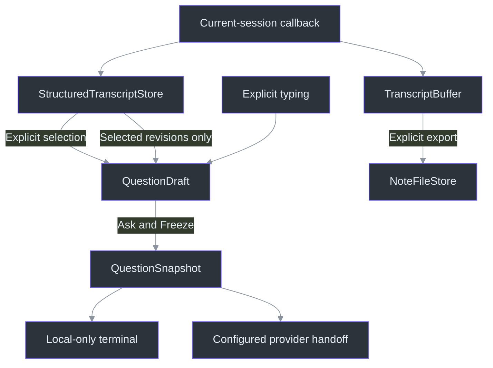
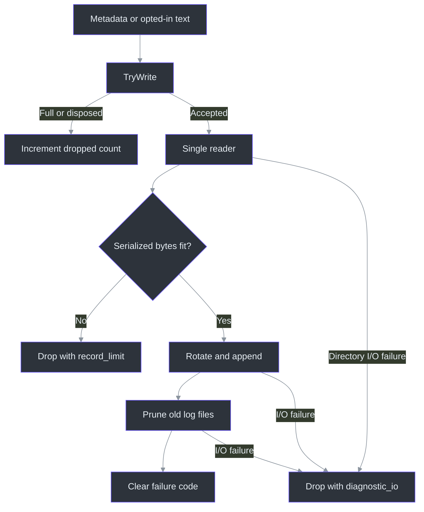

# Domain source walkthrough

## Why these boundaries exist

Recognition can revise an utterance after a person selects it. A bounded history can evict that utterance. A person can correct its wording, and another process can change a note file while it is open. The domain layer keeps these events from silently becoming permission to replace a selected question, discard export history or overwrite an observed external edit. Its mechanisms are explicit identity, staged updates, copied values and operation-specific limits—not one universal “immutable state” abstraction. (src/PhantomFudge.Core/StructuredTranscriptStore.cs:37) (src/PhantomFudge.Core/QuestionDraft.cs:18) (src/PhantomFudge.Core/NoteFileStore.cs:47)

This chapter accompanies authored annotations for **22 files / 2,814 physical lines**: eleven Core files and eleven test/project files. Use the [source atlas](../source-atlas/index.html) for complete source and focused excerpts, and the [atlas guide](../source-atlas/README.md) for navigation. Provider internals are a separate ownership boundary; here, the question chain ends at a local snapshot or the application's explicit handoff.

## 1. Follow the data, not the rendered labels

An input is `Computer` or `Microphone`; `Both` belongs to the separate capture-mode enum, not to a segment's source. Wire labels are lowercase protocol tokens, while display labels are `Computer` and `Mic`. Neither is a speaker identity. Invalid numeric sources throw rather than becoming a default input. (src/PhantomFudge.Core/AudioSource.cs:3) (tests/PhantomFudge.Core.Tests/SourceTranscriptTests.cs:81)



The application rejects callbacks whose capture GUID differs from the current question transcript session, updates the export buffer, then updates structured state and refreshes the selected draft. These are sequential operations, **not a transaction across both stores**: a structured-store failure can occur after the export buffer accepted an event. The outer handler stops transcription on the covered data/capacity errors. (src/PhantomFudge.App/MainWindow.xaml.cs:781) (src/PhantomFudge.App/MainWindow.Questions.cs:132)

### Four identity fields, two kinds of revision

`TranscriptSegmentKey` contains capture session GUID, source, source epoch and local segment ID. A segment's revision describes changes to that key; its protocol final ID is separate metadata. A question has its own GUID and draft revision. Equating any of these counters would make a late event capable of targeting the wrong selection. (src/PhantomFudge.Core/TranscriptSegment.cs:3) (src/PhantomFudge.Core/QuestionDraft.cs:11)

The store preserves a key from partial through final, increments revision for changed text and for finalization, and does not increment it for an identical partial. Local IDs survive `Clear` within that store instance. Final IDs instead reset on `BeginSession` and use one session-global high-water mark across inputs. Even an empty final advances that mark, so duplicate tracking does not grow with an empty-final flood. This deliberately assumes ordered global final delivery; it is not an out-of-order reconciliation algorithm. (src/PhantomFudge.Core/StructuredTranscriptStore.cs:47) (src/PhantomFudge.Core/StructuredTranscriptStore.cs:73) (src/PhantomFudge.Core/StructuredTranscriptStore.cs:97)

A new epoch closes only that input's active partial. A new session closes all active partials. Closing means inactive **and still nonfinal**, with no invented final ID. The short session suffix in `DisplayText` is only a visual aid; full-key equality remains authoritative. Session reuse checks cover the current GUID and retained history, not every GUID ever evicted. The desktop ingestion calls currently use the store's default epoch zero. (src/PhantomFudge.Core/StructuredTranscriptStore.cs:24) (src/PhantomFudge.Core/StructuredTranscriptStore.cs:123) (src/PhantomFudge.Core/TranscriptSegment.cs:60) (src/PhantomFudge.App/MainWindow.Questions.cs:135)

## 2. Two transcript stores intentionally disagree about overflow

The export buffer preserves earlier words; the selection store preserves usable bounded state. Their limits and return values must not be interchanged. (src/PhantomFudge.Core/TranscriptBuffer.cs:48) (src/PhantomFudge.Core/StructuredTranscriptStore.cs:67)

| Concern | `TranscriptBuffer` | `StructuredTranscriptStore` |
|---|---|---|
| Representation | Formatted committed text plus per-source partials | Immutable segment records and structured keys |
| Default bound | 250,000 committed/formatted UTF-16 units | 256 retained rows and 64,000 text units |
| Overflow | Reject append; set `IsFull`; preserve old text | Evict eligible whole historical rows, otherwise reject |
| Empty accepted final | Clear its partial; return false because no line appended | Settle matching partial; return true |
| Restart | Archive unfinished text and append separator | Close active records without making finals |

Sources: (src/PhantomFudge.Core/TranscriptBuffer.cs:8) (src/PhantomFudge.Core/TranscriptBuffer.cs:23) (src/PhantomFudge.Core/TranscriptBuffer.cs:62) (src/PhantomFudge.Core/StructuredTranscriptStore.cs:13) (src/PhantomFudge.Core/StructuredTranscriptStore.cs:80)

The structured store's consequential loop is:

```csharp
var characters = updated.Sum(segment => (long)segment.Text.Length);
while (updated.Count > maximumSegments || characters > maximumCharacters)
{
    var index = updated.FindIndex(segment => !segment.IsActive && segment.Key != changedKey);
    if (index < 0)
        throw new InvalidOperationException("The transcript capacity cannot retain this update and the live partials. Finish or clear capture before retrying.");
    characters -= updated[index].Text.Length;
    updated.RemoveAt(index);
}
segments = updated;
```

The cast makes aggregate arithmetic wide. Both budgets must fit. The victim predicate protects every live partial **and the incoming/changed row**, including a just-finalized row. Removal follows retained-list order, not timestamps. Most importantly, `updated` is a candidate list: failure does not publish its evictions, and callers commit epoch/local/final counters only after this method succeeds. “Evict the oldest row unconditionally” would lose a selected live partial; “truncate the incoming string” would change the question's meaning. (src/PhantomFudge.Core/StructuredTranscriptStore.cs:134) (src/PhantomFudge.Core/StructuredTranscriptStore.cs:94)

The export buffer instead preflights the formatted line before consuming a final ID or clearing its source partial. Session archival likewise checks capacity before clearing partials. `ExportText` can exceed the committed-text limit because it adds live unfinished text and markers; `IsFull` blocks restart but is not checked as a universal mutation guard by `SetPartial`/`AddFinal`. Total-hour formatting prevents 25 hours from wrapping to one. (src/PhantomFudge.Core/TranscriptBuffer.cs:27) (src/PhantomFudge.Core/TranscriptBuffer.cs:58) (src/PhantomFudge.Core/TranscriptBuffer.cs:75)

## 3. Copying is what makes “the question I reviewed” stable

Getter-only sealed segment/key records prevent in-place mutation. `Segments` copies the list into a read-only array but can share immutable records. Selection copies records and keys; freezing copies them again. A read-only wrapper around the caller's original mutable list would not provide the same isolation. Positional `NoteSnapshot` and `ThemePalette` records have generated init properties, so do not generalize the transcript types' getter-only shape to every record. (src/PhantomFudge.Core/TranscriptSegment.cs:52) (src/PhantomFudge.Core/StructuredTranscriptStore.cs:22) (src/PhantomFudge.Core/QuestionSnapshot.cs:11) (src/PhantomFudge.Core/NoteFileStore.cs:6) (src/PhantomFudge.Core/ThemePalette.cs:5)

`ReplaceSelection` stages enumeration, enforces one capture session, deduplicates complete keys in supplied order and takes the first occurrence—not a hidden later revision. Only after copying and bounded composition succeeds does it publish text/selection. A throwing iterator, mixed sessions or excessive text therefore leaves the earlier draft intact. (src/PhantomFudge.Core/QuestionDraft.cs:18) (tests/PhantomFudge.Core.Tests/QuestionDraftTests.cs:374)

Two short statements encode edit ownership:

```csharp
// EditText, after optional text/revision replacement:
UserEdited = true;
// Refresh, after its null-store guard:
if (UserEdited || SelectedSegments.Count == 0)
    return;
```

Reasserting identical text is still an edit, although it does not increment the revision. Refresh otherwise considers only selected, previously nonfinal keys with a strictly newer source revision. Missing copies remain selected; their saved `IsActive` value is not proof that capture still runs. New utterances do not enter automatically; selected finals are not rewritten. Explicit replacement resets `UserEdited` and reenables refresh. (src/PhantomFudge.Core/QuestionDraft.cs:48) (src/PhantomFudge.Core/QuestionDraft.cs:61)

An oversized refresh fails before changing text, provenance or revision. An empty final, however, is meaningful: it settles a selected guess to empty rather than preserving guessed words. Empty source texts add no join separators, while whitespace-only source texts remain literal. `Freeze` rejects a blank final question but otherwise preserves exact text and samples `Stopwatch` ticks; those ticks are not UTC or milliseconds. (src/PhantomFudge.Core/QuestionDraft.cs:90) (src/PhantomFudge.Core/QuestionDraft.cs:105) (tests/PhantomFudge.Core.Tests/QuestionDraftTests.cs:255)

### Entry to terminal: an explicit Ask

`QuestionAsk_Click` checks reply/busy/provider/protection/file-operation conditions, freezes the current draft, displays `ExactText`, then chooses clarification or ordinary answer handoff. `StartAnswer` returns after local snapshot handling when providers are disabled. `Freeze` itself never sends. Clarify-first starts false; normal Ask supplies no clarification argument/history. Opt-in clarification requires an explicit Yes or correction submission, and a written correction is not silently discarded by the confirm button. Azure is not connected by this local snapshot path. (src/PhantomFudge.App/MainWindow.Questions.cs:258) (src/PhantomFudge.App/MainWindow.Answers.cs:137) (src/PhantomFudge.App/MainWindow.Clarification.cs:11) (src/PhantomFudge.App/MainWindow.Clarification.cs:114)

An edited snapshot can contain corrected `ExactText` and original, uncorrected ASR in `SourceRefs`. That is intentional local provenance, not permission to send the whole snapshot. It can also remain `WasProvisional=true` after correction because that flag describes selected recognition. (src/PhantomFudge.Core/QuestionSnapshot.cs:8) (tests/PhantomFudge.Core.Tests/QuestionSnapshotTests.cs:101)

## 4. “Characters” is not one portable unit

| Boundary | Actual unit and limit | Important exclusion |
|---|---|---|
| Segment text | 16,384 UTF-16 code units | Not Unicode scalar or UTF-8 validation |
| Draft text | 8,192 UTF-16 units, including actual join separators | No silent trimming |
| Selected provenance | 256 unique keys | Empty-text records still count |
| Segment offsets | Optional finite seconds, inclusive 0..2,592,000 | Not monotonic timestamp ticks |
| Note file | 1,048,576 UTF-8 bytes including optional BOM | Not `string.Length` |
| Opted-in diagnostic text | Prefix of 32,768 UTF-16 units | Not a byte/grapheme-safe truncation |

Sources: (src/PhantomFudge.Core/TranscriptSegment.cs:25) (src/PhantomFudge.Core/TranscriptSegment.cs:84) (src/PhantomFudge.Core/QuestionDraft.cs:8) (src/PhantomFudge.Core/QuestionDraft.cs:113) (src/PhantomFudge.Core/NoteFileStore.cs:19) (src/PhantomFudge.Core/Diagnostics/LocalDiagnostics.cs:179)

**C# → Python, explanatory pseudocode—not production code:** a direct translation using Python `len(text)` changes the .NET budget for supplementary characters. Count UTF-16 units when modeling the draft, but strict UTF-8 bytes when modeling notes:

```python
def dotnet_units(text):
    return len(text.encode("utf-16-le", errors="surrogatepass")) // 2

def note_bytes(text, with_bom):
    return len(text.encode("utf-8", errors="strict")) + (3 if with_bom else 0)
```

**Python → JavaScript, explanatory pseudocode—not production code:** JavaScript string length returns the UTF-16 count directly. This translation concerns the draft budget, not strict UTF-8 note validation:

```javascript
const dotnetUnits = text => text.length;
const questionFits = text => dotnetUnits(text) <= 8192;
```

For example, a supplementary emoji contributes two units to the draft budget but four UTF-8 bytes to a note. A lone surrogate is not rejected by the domain text-length guard, but `NoteFileStore.Fits` rejects its strict encoding. Do not insert Unicode normalization into either translation: combining marks, whitespace and newline spelling are preserved by the actual question path. (src/PhantomFudge.Core/TranscriptSegment.cs:84) (src/PhantomFudge.Core/NoteFileStore.cs:13) (tests/PhantomFudge.Core.Tests/NoteFileStoreTests.cs:92) (tests/PhantomFudge.Core.Tests/QuestionSnapshotTests.cs:14)

## 5. Local storage: optimistic conflict detection, not a lock

`ReadAsync` checks accumulated bytes during 16,384-byte reads, detects/removes only a leading UTF-8 BOM for decoding, and hashes the original bytes **including** that BOM. A byte-identical file yields the same fingerprint; visually equivalent text with different encoding bytes need not. `FileShare.ReadWrite` permits other writers, so the read is not guaranteed to be a coherent point-in-time snapshot of an actively changing file. (src/PhantomFudge.Core/NoteFileStore.cs:27)

The write chain is deliberately ordered:

1. Strictly encode within the byte budget; choose a same-directory GUID temporary.
2. Verify the expected target state before creating that temporary.
3. Write, flush asynchronously, request disk flush and close the handle.
4. Reverify the target; check cancellation; move the temporary into place.
5. Return the new byte fingerprint; delete any leftover temporary in `finally`.

Each ordering point is visible in `WriteAsync`; none is an automatic save trigger. (src/PhantomFudge.Core/NoteFileStore.cs:47)

A null fingerprint means **create-only**. A nonnull fingerprint means the file must still exist and match; deletion is a conflict, not permission to recreate. The second check narrows a race but does not close the check-to-move interval, and cleanup can itself throw. This is neither filesystem compare-and-swap nor a claim of power-loss-proof publication. SHA-256 here is a content-change detector, not encryption or an authorization credential. (src/PhantomFudge.Core/NoteFileStore.cs:71) (src/PhantomFudge.Core/NoteFileStore.cs:83)

The application captures editor content, calls this service, and updates saved state only on success. Its conflict/error handlers retain edits; transcript export uses the same store after an explicit export action. Native dialogs and files on disk are outside screen-capture exclusion. (src/PhantomFudge.App/MainWindow.xaml.cs:389) (src/PhantomFudge.App/MainWindow.xaml.cs:813)

## 6. Diagnostics: keep latency bounded and failure visible

Diagnostic privacy belongs primarily to `LocalDiagnostics`, not the raw `DiagnosticRecord` or `JsonlDiagnosticLog`. Metadata events validate enum, nonnegative numbers, a provider allowlist and a short restricted code alphabet. That alphabet prevents arbitrary sentences/paths but cannot identify secrets embedded in a syntactically valid token. The raw sink accepts supplied `Text`; callers must use the appropriate facade. (src/PhantomFudge.Core/Diagnostics/LocalDiagnostics.cs:20) (src/PhantomFudge.Core/Diagnostics/LocalDiagnostics.cs:60) (src/PhantomFudge.Core/Diagnostics/LocalDiagnostics.cs:162)



The channel defaults to 1,024 records. Although its full mode is `Wait`, producers use `TryWrite`, so they do not await space: rejected/disposed submissions increment an interlocked counter. Enqueue success is not persistence success. The single reader measures UTF-8 bytes **after JSON serialization**, drops individually oversized lines, rotates before exceeding 2 MiB and retains ten ordinary matching files through pruning. Record-count capacity is not an aggregate memory-byte cap. (src/PhantomFudge.Core/Diagnostics/LocalDiagnostics.cs:40) (src/PhantomFudge.Core/Diagnostics/LocalDiagnostics.cs:71)

Retention enumerates directory-wide `events-*.jsonl`, excludes the current file and reparse-point files, and keeps the newest remaining files by last-write time. It is not isolated by logger identity; simultaneous writers and skipped links limit any blanket directory-size guarantee. The directory reparse check is useful defense, not race-free path confinement. (src/PhantomFudge.Core/Diagnostics/LocalDiagnostics.cs:77) (src/PhantomFudge.Core/Diagnostics/LocalDiagnostics.cs:103)

Covered I/O/permission failures set `diagnostic_io`, increment drops and emit a generic Trace message. An append followed by prune failure may count as dropped despite existing on disk. Success clears the failure code but not cumulative drops. Disposal completes the channel and waits three seconds; `flush_timeout` does not cancel the writer, and unhandled writer faults can surface through `Wait`. The UI polls failure/drop properties separately. (src/PhantomFudge.Core/Diagnostics/LocalDiagnostics.cs:90) (src/PhantomFudge.Core/Diagnostics/LocalDiagnostics.cs:113) (src/PhantomFudge.App/MainWindow.Diagnostics.cs:46)

Settings reload first disables content, then accepts only a small JSON object containing one Boolean `includeText`. Failure cannot preserve a previously enabled flag; disabling it does not purge previously queued or written content. Opted-in content records retain original length and a bounded prefix; ordinary metadata does not include text bodies. Exception logging omits messages/paths and bounds sanitized method frames to four exception levels and eight frames each. These are local diagnostic policies, not guarantees about external provider retention. (src/PhantomFudge.Core/Diagnostics/LocalDiagnostics.cs:145) (src/PhantomFudge.Core/Diagnostics/LocalDiagnostics.cs:172) (src/PhantomFudge.Core/Diagnostics/LocalDiagnostics.cs:187)

## 7. Visual constants remain pure domain data

Palette roles separate ordinary UI foregrounds from exact white/black `HighContrastReading`; WPF consumes the strings as frozen brushes. `For` rejects unknown themes, while `NextThemed` alternates the two companion themes and maps every other value, including Plain, to DeepSeaFoam. Contrast tests calculate opaque sRGB pairs, not contrast over arbitrary translucent desktop imagery. (src/PhantomFudge.Core/ThemePalette.cs:11) (src/PhantomFudge.App/ThemeBrushes.cs:9) (tests/PhantomFudge.Core.Tests/ThemePaletteTests.cs:31)

Layout requests 1240×1520, nominal minima 470×560, twelve-unit edges and columns at width 900 inclusive. `FitToWorkArea` validates the available area, reduces insets/minima on small displays, clamps requested size, then clamps position using that fitted size. Missing/nonfinite requested coordinates center; invalid work-area dimensions throw. Monitor discovery and device-to-WPF coordinate conversion belong to the caller, not this arithmetic helper. (src/PhantomFudge.Core/WorkspaceLayout.cs:8) (src/PhantomFudge.Core/WorkspaceLayout.cs:17) (src/PhantomFudge.App/MainWindow.Layout.cs:41)

## 8. Read negative controls as evidence, not qualification

The annotated tests make preservation observable, often by keeping prior object references as well as strings:

| Negative control | What its assertions distinguish |
|---|---|
| Replay final ID with a higher epoch | Rejection must not poison epoch state or clear another input. (tests/PhantomFudge.Core.Tests/StructuredTranscriptStoreTests.cs:95) |
| Fail capacity, then retry the same final ID in the old epoch | Failure must not consume ID/epoch or publish staged evictions. (tests/PhantomFudge.Core.Tests/StructuredTranscriptStoreTests.cs:302) |
| Yield one selection item, then throw | Enumeration must complete before selection commits. (tests/PhantomFudge.Core.Tests/QuestionDraftTests.cs:374) |
| Exact joined limit, then one extra segment | Newline units count and rejection preserves the prior collection. (tests/PhantomFudge.Core.Tests/QuestionDraftTests.cs:405) |
| Freeze, then revise/finalize/evict/edit/clear/restart | Snapshot text and full provenance remain independent. (tests/PhantomFudge.Core.Tests/QuestionSnapshotTests.cs:30) |
| Pre-cancel a save | Original file survives; this does not inject every mid-write cancellation race. (tests/PhantomFudge.Core.Tests/NoteFileStoreTests.cs:101) |
| Ordinary file where log directory should be | I/O failure becomes an observable code/drop count. (tests/PhantomFudge.Core.Tests/LocalDiagnosticsTests.cs:43) |

The rotation test uses 200 queue slots for 100 small records: it does **not** saturate the queue or submit an individually oversized record. Snapshot tests use sequential mutations, not concurrent writers. Palette/layout tests use mathematical fixtures, not recipient capture or human UX approval. These distinctions matter more than a broad “tested” label. (tests/PhantomFudge.Core.Tests/LocalDiagnosticsTests.cs:27) (tests/PhantomFudge.Core.Tests/QuestionSnapshotTests.cs:30) (tests/PhantomFudge.Core.Tests/WorkspaceLayoutTests.cs:17)

This work is source research, not a new execution result. Mechanical line coverage cannot prove every subtle behavior has been understood. External .NET/xUnit implementations, real devices, live providers, filesystem races and recipient-side capture remain separate boundaries; the project/test declarations identify dependencies, not passing qualification. (src/PhantomFudge.Core/PhantomFudge.Core.csproj:1) (tests/PhantomFudge.Core.Tests/PhantomFudge.Core.Tests.csproj:10)
