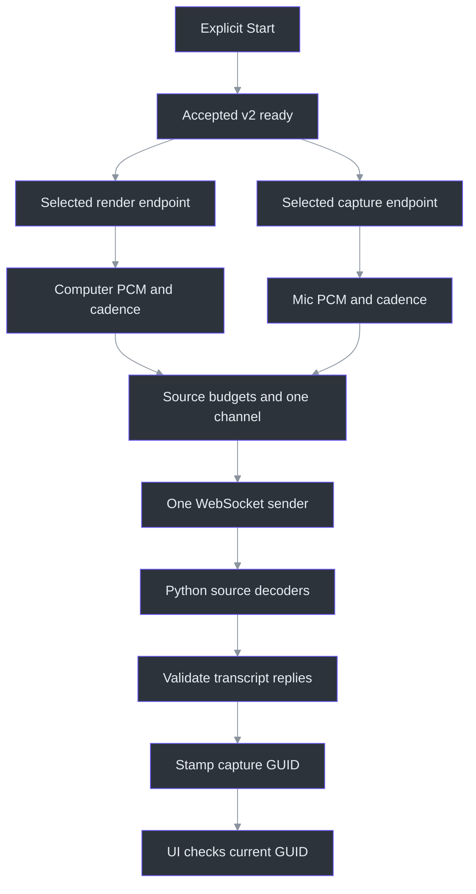
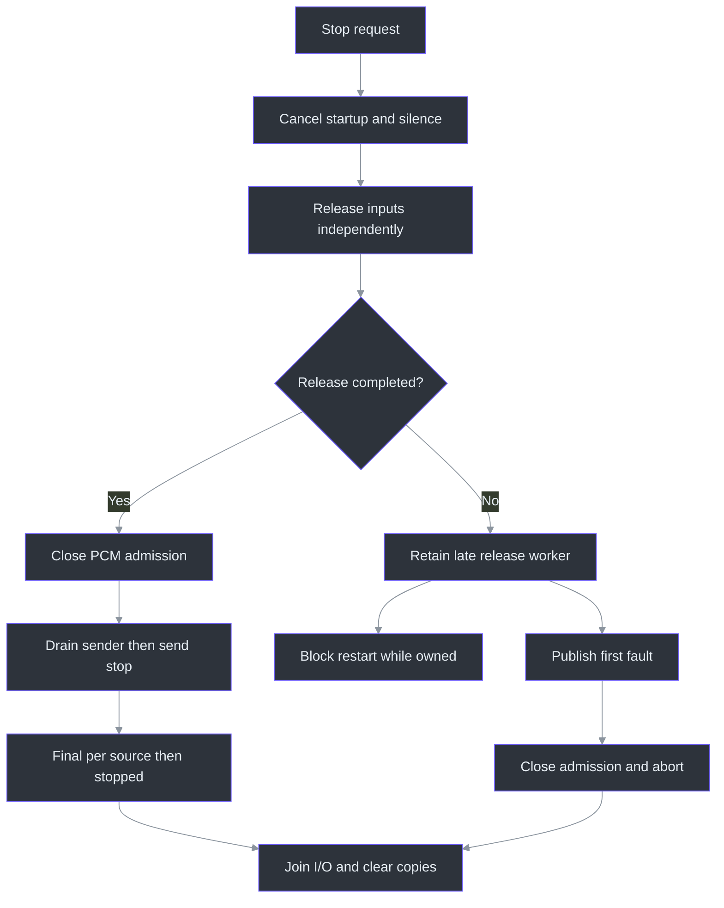

# Native audio: source ownership, bounded transport and evidence limits

## 1. Why this boundary exists

Computer output and microphone input answer different questions: “what played on this output?” and “what entered this microphone?” Mixing their waveforms would discard that provenance before recognition. The adapter instead owns a separate `Input` for each selected endpoint and sends source-labelled PCM through one transport. Computer capture is endpoint loopback, not a meeting-process filter; these labels are not speaker identification. (`src/PhantomFudge.App/Audio/LoopbackTranscriber.cs:142`) (`src/PhantomFudge.App/Audio/WasapiInput.cs:48`)

This chapter documents **source, not a new audio or capture result**. Its 16 files cover 3,586 physical lines in 147 contiguous annotation blocks with 58 focused excerpts. The [source atlas](../source-atlas/index.html) carries the complete source/block pairing; its [reader guide](../source-atlas/README.md) explains navigation. Reading these files did not run their tests, sockets, models, playback or capture windows. Documentation rendering and hash/coverage checks are recorded separately in the edition manifests.

The entry path remains deliberate: `Start_Click` checks busy/running state, protection, requested devices and token before calling the adapter. Constructor event wiring does not start capture. A missing requested device is not silently replaced. (`src/PhantomFudge.App/MainWindow.xaml.cs:637`) (`src/PhantomFudge.App/MainWindow.xaml.cs:65`) (`src/PhantomFudge.App/Audio/WasapiInput.cs:46`)

## 2. Architecture: two input owners, one ordered sender



The diagram follows `StartCoreAsync`, `OnAudio`, `SendAudioAsync` and the actual UI subscriber—not hypothetical layers. The Python handler constructs one decoder per declared source before replying ready. (`src/PhantomFudge.App/Audio/LoopbackTranscriber.cs:95`) (`src/PhantomFudge.App/Audio/LoopbackTranscriber.cs:266`) (`src/PhantomFudge.App/Audio/TranscriptionSocket.cs:322`) (`services/transcription/server.py:565`) (`src/PhantomFudge.App/MainWindow.xaml.cs:781`)

### Readiness precedes device construction

The legacy string overload selects v1 Computer-only capture. The selection-record overload selects v2, including Mic-only or Computer-only operation. A fresh capture GUID accompanies either. Before admission, `_stopVersion` is sampled; after waiting for `_lifecycle`, the value is compared under `_requestLock`. Thus Stop can invalidate a queued Start before it publishes another session. An existing session, pending release worker or sticky release failure prevents restart. (`src/PhantomFudge.App/Audio/LoopbackTranscriber.cs:65`) (`src/PhantomFudge.App/Audio/LoopbackTranscriber.cs:75`)

Only accepted ready allows `Task.Run` to construct the inputs. The source explains why: NAudio can capture a synchronization context at construction, while native start/join can block. `Running` becomes true only after every start succeeds without a stopped event or failure. A ten-second wait limit does **not** terminate a blocked worker. (`src/PhantomFudge.App/Audio/LoopbackTranscriber.cs:110`)

### Where resampling actually belongs

The consequential source statements are:

```csharp
_capture = source == AudioSource.Computer
    ? new WasapiLoopbackCapture(_device)
    : new WasapiCapture(_device);
// NAudio 2.2.1 supplies AutoConvertPcm | SrcDefaultQuality for shared capture,
// including loopback. Keep separate resampled tracks, never a mixed waveform.
_capture.ShareMode = AudioClientShareMode.Shared;
_capture.WaveFormat = new WaveFormat(TranscriptionSocket.SampleRate, 16, 1);
```

The constructor selects loopback versus input capture, then requests shared-mode 16-kHz, 16-bit mono. There is **no first-party resampling loop here**. The conversion flags are attributed by the source comment to NAudio; its implementation, Windows conversion/filtering and actual device negotiation were not inspected or exercised. Do not turn this request into a claim about resampling quality or successful hardware conversion. (`src/PhantomFudge.App/Audio/WasapiInput.cs:48`)

Selection first requires exact ordinal endpoint ID, correct Render/Capture direction and Active state. Nonselected enumerated devices are disposed. Default-device changes are deliberately ignored; selected-device invalidation queues one fault off the Core Audio notification callback. Substituting the new default would violate the recorded source choice. (`src/PhantomFudge.App/Audio/WasapiInput.cs:28`) (`src/PhantomFudge.App/Audio/WasapiInput.cs:64`) (`src/PhantomFudge.App/Audio/RenderEndpointNotification.cs:20`)

## 3. Bytes, samples, source IDs and queue ownership

| Quantity | Meaning |
|---|---|
| 16,000 | Mono samples per second |
| 2 | Bytes per signed little-endian PCM sample |
| 32,000 | PCM bytes per second; also maximum PCM frame size |
| 3,200 | A 100-ms PCM frame, including synthetic silence |
| 64,000 | Maximum pending PCM bytes per source |
| 128,000 | Maximum pending PCM bytes across both sources |
| 1 / 2 | Binary source tags: Computer / Microphone |
| 32,001 | Maximum v2 wire payload: one tag plus 32,000 PCM bytes |

These follow the transport constants, silence allocation and byte-valued `AudioSource` enum. The wire names are exactly `computer` and `microphone`; display name `Mic` is not a protocol value. (`src/PhantomFudge.App/Audio/TranscriptionSocket.cs:13`) (`src/PhantomFudge.App/Audio/LoopbackTranscriber.cs:15`) (`src/PhantomFudge.Core/AudioSource.cs:3`) (`src/PhantomFudge.Core/AudioSource.cs:18`)

`OnAudio` rejects negative, oversized-relative-to-buffer and odd byte counts. Its per-input lock serializes real packets with silence scheduling. Diagnostics count `BytesRecorded / 2` samples and near-full-scale values, not transcript/audio bodies. Large callbacks are split on an even 32,000-byte boundary. RMS reads signed samples, divides by 32768, averages squared values and takes the square root; aggregate level is the **maximum of latest source levels**, not mixed audio energy. (`src/PhantomFudge.App/Audio/LoopbackTranscriber.cs:239`) (`src/PhantomFudge.App/Audio/LoopbackTranscriber.cs:267`) (`src/PhantomFudge.App/Audio/LoopbackTranscriber.cs:288`)

### The copy is an ownership transfer, not optional overhead

```csharp
int prefix = _protocolVersion == 2 ? 1 : 0;
byte[] copy = new byte[pcm.Length + prefix];
if (prefix != 0)
    copy[0] = (byte)source;
pcm.CopyTo(copy.AsSpan(prefix));
_pendingBytes += pcm.Length;
_pendingBySource[index] += pcm.Length;
```

1. `prefix` preserves untagged v1 compatibility.
2. `copy` disconnects queued data from a reusable capture buffer.
3. Byte zero identifies the source, never a sample.
4. Only PCM length consumes time-based budgets; the tag consumes no audio duration.

Admission uses a single bounded channel with per-source counters, **not two native transport channels**. Pending includes an in-flight send until `ReleaseFrame` runs. Channel item capacity, copied-array overhead and external socket buffers mean 128,000 is not a whole-process memory bound. Overflow faults the session rather than silently dropping a frame; an abort can still leave accepted audio without a final transcript. (`src/PhantomFudge.App/Audio/TranscriptionSocket.cs:213`) (`src/PhantomFudge.App/Audio/TranscriptionSocket.cs:217`) (`src/PhantomFudge.App/Audio/TranscriptionSocket.cs:326`) (`src/PhantomFudge.App/Audio/TranscriptionSocket.cs:552`)

### C# → Python: strip the tag before measuring samples

Explanatory pseudocode, **not production or a replacement validator**:

```python
# Equivalent interpretation of the C# v2 frame:
source_id = wire[0]
pcm = wire[1:]
sample_count = len(pcm) // 2
duration_seconds = len(pcm) / 32000
```

The real Python receiver maps byte zero, rejects undeclared sources, strips it, then checks nonempty/even/bounded PCM. Source-local byte and frame credits and queues remain distinct from client budgets. The publication lock serializes global IDs; timestamps use each source's own accepted duration. Hybrid mode uses source queues/workers and a separate finalizer, whereas the nonhybrid path consumes one shared work queue with separate decoder state. Neither branch mixes waveforms. (`services/transcription/server.py:319`) (`services/transcription/server.py:342`) (`services/transcription/server.py:361`) (`services/transcription/server.py:394`) (`services/transcription/server.py:477`)

Treating 32,001 wire bytes as PCM fails twice: it is odd-length “audio” and contaminates time/sample interpretation with an identity byte. Conversely, omitting the v2 tag makes the first sample byte masquerade as a source. The dual drain helper explicitly tests odd **wire** lengths of 3..32,001 containing even **PCM**. (`tests/PhantomFudge.Audio.Tests/DualSourceTests.cs:75`)

### Silence is cadence, not reconstructed elapsed audio

Real packets reset both cadence timestamps. A timer may add one 100-ms zero frame only after 250 ms without a real packet and 100 ms since prior silence. Assigning the last-silence timestamp to `now` prevents catch-up bursts after scheduler delay. Each source decides independently. Thus timestamps are submitted-audio-relative, not guaranteed synchronized wall-clock meeting time. (`src/PhantomFudge.App/Audio/SilenceCadence.cs:11`) (`src/PhantomFudge.App/Audio/LoopbackTranscriber.cs:313`)

## 4. From untrusted socket messages to identified callbacks

Literal-loopback restriction is unusually specific: validation uses the URI's original spelling, allowing only `ws://127.0.0.1` or its literal IPv6 equivalent with the exact transcription path. DNS names, normalized/escaped alternatives, credentials and query tokens are rejected. Proxies and redirects are disabled. This limits routing; it does not provide encryption or prove the local server's OS identity. (`src/PhantomFudge.App/Audio/TranscriptionSocket.cs:27`) (`src/PhantomFudge.App/Audio/TranscriptionSocket.cs:82`)

Inbound fragments must form a text message within 32,768 bytes and JSON depth eight. Duplicate properties are rejected before lookup. v2 ready requires the exact field set, version, format and canonical source order. Legacy initial ready checks format but does not apply that same exact-key-set guard. Do not describe v1 and v2 strictness as identical. (`src/PhantomFudge.App/Audio/TranscriptionSocket.cs:352`) (`src/PhantomFudge.App/Audio/TranscriptionSocket.cs:398`) (`src/PhantomFudge.App/Audio/TranscriptionSocket.cs:416`)

For finals:

- IDs must strictly increase **globally**, but need not be consecutive.
- Times must be finite/nonnegative, with end not before start.
- End is bounded by that source's **admitted** PCM duration plus one second—not confirmed decoded bytes.
- v2 start cannot precede that source's previous end; Computer and Mic clocks are not compared to each other.
- Empty text is valid, including a terminal final.

After stop is marked sent, every selected v2 source must contribute a final before `stopped` is accepted. Remote error strings are validated for shape but replaced with a fixed safe message, preventing backend paths/secrets from becoming UI errors. (`src/PhantomFudge.App/Audio/TranscriptionSocket.cs:406`) (`src/PhantomFudge.App/Audio/TranscriptionSocket.cs:446`) (`src/PhantomFudge.App/Audio/TranscriptionSocket.cs:468`)

`TranscriptEvent` is only a record; it does not validate itself. The socket publishes validated fields, the adapter copies in its capture GUID, and `MainWindow` dispatches onto the UI thread. `ReceiveTranscript` rejects a callback whose GUID differs from the current structured transcript session. This prevents delayed old-session text entering a new capture; source identity and session identity solve different problems. (`src/PhantomFudge.App/Audio/TranscriptEvent.cs:9`) (`src/PhantomFudge.App/Audio/LoopbackTranscriber.cs:95`) (`src/PhantomFudge.App/MainWindow.xaml.cs:65`) (`src/PhantomFudge.App/MainWindow.xaml.cs:783`)

## 5. Stop is an ordered protocol, not merely a cancellation token



This shows the healthy path plus the capture-release-timeout branch. Other faults can enter the same abort path at any stage; release completion with a disposal failure also remains faulted. (`src/PhantomFudge.App/Audio/LoopbackTranscriber.cs:362`) (`src/PhantomFudge.App/Audio/LoopbackTranscriber.cs:401`) (`src/PhantomFudge.App/Audio/TranscriptionSocket.cs:241`)

| Synchronization mechanism | Why it is separate |
|---|---|
| Adapter `_lifecycle` | Serialize Start/Stop/Dispose without blocking immediate stop requests |
| `_requestLock` and version | Invalidate queued starts before semaphore acquisition |
| Per-input `AudioGate` | Order that source's real packets and silence |
| Session `StateGate` | Coordinate running state and max-latest meters |
| Socket `_queueLock` | Protect admission, accepted bytes and pending counters |
| Socket `_resourceLock` | Prevent abort racing disposed socket/token resources |

The declarations and transitions—not lock names alone—establish these responsibilities. Fault callbacks deliberately avoid taking the other input's audio lock, preventing reciprocal Computer/Mic lock acquisition. (`src/PhantomFudge.App/Audio/LoopbackTranscriber.cs:16`) (`src/PhantomFudge.App/Audio/LoopbackTranscriber.cs:364`) (`src/PhantomFudge.App/Audio/LoopbackTranscriber.cs:496`) (`src/PhantomFudge.App/Audio/TranscriptionSocket.cs:32`)

Normal stop clears Running and cancels silence but initially retains real callback admission, allowing driver tail packets until release. Each independent worker awaits late startup, calls StopRecording, awaits RecordingStopped when appropriate, disposes capture and detaches handlers. `WasapiInput.Dispose` attempts capture release before notification unregistration, device disposal and enumerator disposal through nested `finally` blocks. Its NAudio join expectation remains an external-library boundary. (`src/PhantomFudge.App/Audio/LoopbackTranscriber.cs:449`) (`src/PhantomFudge.App/Audio/WasapiInput.cs:97`)

The outer five-second release wait cannot revoke driver ownership. `_pendingCaptureRelease` retains workers; a completed but failed disposal sets a sticky restart prohibition. Healthy transport disposal then closes admission, drains its single sender, sends stop, accepts finals/stopped and closes output under a separate default 90-second flush deadline. Consequently **“Stop always finishes in five seconds” is false**. Faults instead disable both inputs and abort; already-published valid text is not retracted. (`src/PhantomFudge.App/Audio/LoopbackTranscriber.cs:410`) (`src/PhantomFudge.App/Audio/LoopbackTranscriber.cs:479`) (`src/PhantomFudge.App/Audio/TranscriptionSocket.cs:264`)

## 6. What the synthetic checks actually establish

The executable test project links production `Audio/*.cs` into its assembly, exposes internal seams without changing production visibility, and hosts scripted loopback servers through ASP.NET Core. Its default table contains 20 base groups plus 26 dual-source groups; tests are definitions here, not newly reported passes. (`tests/PhantomFudge.Audio.Tests/PhantomFudge.Audio.Tests.csproj:7`) (`tests/PhantomFudge.Audio.Tests/Program.cs:34`) (`tests/PhantomFudge.Audio.Tests/DualSourceTests.cs:17`)

| Test family | Arrangement and discriminating assertion | Limit |
|---|---|---|
| Copy/framing | Mutate source arrays and PCM after admission; preserved source bytes and global IDs must arrive | No conversion/recognition measurement |
| Backpressure | Hold `_queueLock` by reflection; 64,000 PCM bytes per source fit, another sample faults | Not device throughput |
| Dual startup/silence | Withhold ready, then gate Mic start; emit distinct RMS fixtures and keep only Computer active | Synthetic scheduling |
| Late ownership | Block Mic start/stop; responsive Computer releases, restart stays blocked until appropriate | No real driver cancellation proof |
| Cleanup failure | Throw on Dispose or constructor cleanup; prohibit another acquisition | Attempted release is not proven release |

These cases include negative controls rather than just happy-path assertions. (`tests/PhantomFudge.Audio.Tests/DualSourceTests.cs:116`) (`tests/PhantomFudge.Audio.Tests/DualSourceTests.cs:398`) (`tests/PhantomFudge.Audio.Tests/DualSourceTests.cs:526`) (`tests/PhantomFudge.Audio.Tests/DualSourceTests.cs:762`) (`tests/PhantomFudge.Audio.Tests/DualSourceTests.cs:824`)

The large file also genuinely tests process logic: `V2HelperAsync` starts the compiled CLI with redirected stdin/stdout/stderr, supplies tiny base64 fixtures, checks exit/output and bounds/kills its owned child. This is not disposable fixture boilerplate. The separate dual helper accepts at most sixty seconds per track, paces 3,200 bytes every 100 ms and checks expected finals separately. Neither opens capture devices, but both can perform process/network work when invoked. (`tests/PhantomFudge.Audio.Tests/DualSourceTests.cs:197`) (`tests/PhantomFudge.Audio.Tests/DualSyntheticServiceCheck.cs:25`)

`DualSourceProbe` goes further: it loads an installed Vosk or explicitly selected hybrid model into an ephemeral local service. Python mode adds source-keyword contamination controls; native mode exercises the C# client and source-specific expected phrases. `--accurate` requires that native mode. `PlaybackCheck` is a different boundary entirely: it opens the real default render endpoint, plays synthetic PCM and captures loopback. It is not part of ordinary no-endpoint tests or permission to record unrelated output. (`tools/DualSourceProbe/probe.py:19`) (`tools/DualSourceProbe/probe.py:109`) (`tools/DualSourceProbe/probe.py:139`) (`tests/PhantomFudge.Audio.Tests/PlaybackCheck.cs:39`)

### Python → JavaScript: translate bytes, not text

The Python probe sends `bytes([index]) + frame`. Equivalent explanatory JavaScript, **not production and not executed**:

```javascript
// pcm is an even-length Uint8Array; sourceId is 1 or 2.
const wire = new Uint8Array(1 + pcm.length);
wire[0] = sourceId;
wire.set(pcm, 1);
// A binary-capable sender would send wire, not JSON.stringify(wire).
```

This preserves opaque sample bytes and a binary tag; text serialization would violate the actual receiver's binary-frame contract. The real Python probe pads to 3,200 PCM bytes and sends each source at approximately real-time cadence. (`tools/DualSourceProbe/probe.py:96`) (`services/transcription/server.py:317`)

One source-review caveat matters for maintenance: the older “current service is reused” test mocks ready/active/v2 metadata but omits `configFingerprint` and does not mock configuration loading. Current `manage.start` requires both current audio capability **and engine fingerprint** before reuse. Therefore the fixture's name cannot establish current successful reuse; parent test owners should review it without interpreting this documentation pass as execution. Other tests correctly express exact integer v2 detection and refusing shutdown unless activity is literally false. (`tools/DualSourceProbe/test_runtime_upgrade.py:12`) (`tools/DualSourceProbe/test_runtime_upgrade.py:25`) (`services/transcription/manage.py:132`) (`services/transcription/manage.py:171`)

## 7. Local GDI positive control is not recipient qualification

The capture spike links the actual first-party protection/proof source and enters it through an explicit STA WPF executable. Unlike production reveal, the experiment intentionally shows **unprotected synthetic text first**: the red canary must be visible to the cropped GDI path before absence under protection means anything. It then hides the overlay, captures the underlying baseline, configures affinity and samples four show/hide cycles with four samples each. (`spikes/CaptureProof/CaptureProof.csproj:9`) (`spikes/CaptureProof/Program.cs:10`) (`src/PhantomFudge.App/Diagnostics/CaptureProof.cs:42`)

The pass predicate requires more than 20% of baseline pixels to differ in the unprotected positive control, zero differing RGB pixels in protected samples, ToolWindow present and AppWindow absent. `Grab` uses a top-down 32-bit DIB and `BitBlt`; comparisons ignore the fourth byte. Cleanup restores the selected GDI object before deleting the bitmap and releasing contexts. (`src/PhantomFudge.App/Diagnostics/CaptureProof.cs:93`) (`src/PhantomFudge.App/Diagnostics/CaptureProof.cs:148`) (`src/PhantomFudge.App/Diagnostics/CaptureProof.cs:185`)

A successful setter/readback, a settling delay, sixteen equal crops or an OCR miss cannot establish unseen recipient frames. The result deliberately says `PASS_LOCAL_GDI_SAMPLES_ONLY` and excludes Teams, Zoom, Meet, OBS, WGC, first-frame completeness and actual app UX. WindowProtection itself says recipient capture requires independent qualification. This documentation neither ran that experiment nor upgrades any compatibility row. (`src/PhantomFudge.App/Diagnostics/CaptureProof.cs:97`) (`src/PhantomFudge.App/Diagnostics/CaptureProof.cs:112`) (`src/PhantomFudge.App/Diagnostics/CaptureProof.cs:140`) (`src/PhantomFudge.App/Native/WindowProtection.cs:46`)

## 8. Coverage map and remaining uncertainty

Paths below are grouped by repository directory; blocks partition every assigned physical line, including imports, blank lines, fixtures and declarations.

| Directory / file | Lines | Blocks |
|---|---:|---:|
| `spikes/CaptureProof/CaptureProof.csproj` | 13 | 2 |
| `spikes/CaptureProof/Program.cs` | 35 | 3 |
| `src/PhantomFudge.App/Audio/LoopbackTranscriber.cs` | 559 | 22 |
| `src/PhantomFudge.App/Audio/RenderEndpointNotification.cs` | 32 | 3 |
| `src/PhantomFudge.App/Audio/SilenceCadence.cs` | 21 | 2 |
| `src/PhantomFudge.App/Audio/TranscriptEvent.cs` | 16 | 2 |
| `src/PhantomFudge.App/Audio/TranscriptionSocket.cs` | 563 | 22 |
| `src/PhantomFudge.App/Audio/WasapiInput.cs` | 121 | 5 |
| `src/PhantomFudge.App/Diagnostics/CaptureProof.cs` | 250 | 9 |
| `tests/PhantomFudge.Audio.Tests/DualSourceTests.cs` | 919 | 34 |
| `tests/PhantomFudge.Audio.Tests/DualSyntheticServiceCheck.cs` | 93 | 4 |
| `tests/PhantomFudge.Audio.Tests/PhantomFudge.Audio.Tests.csproj` | 13 | 2 |
| `tests/PhantomFudge.Audio.Tests/PlaybackCheck.cs` | 88 | 5 |
| `tests/PhantomFudge.Audio.Tests/Program.cs` | 668 | 22 |
| `tools/DualSourceProbe/probe.py` | 146 | 6 |
| `tools/DualSourceProbe/test_runtime_upgrade.py` | 49 | 4 |
| **Total** | **3,586** | **147** |

The inventory hashes are retained in [the authored annotations](../source-atlas/annotations/audio-native.json); this frozen-runtime pass did not recompute them. Full line coverage is not proof that every subtle behavior is understood. NAudio, .NET socket/framework internals, Windows drivers/composition, model libraries, live devices/providers and recipient capture remain separate boundaries. Array clearing, synthetic assertions and finite local samples must not be promoted into secure-erasure, hardware, speech-quality or universal exclusion guarantees.
