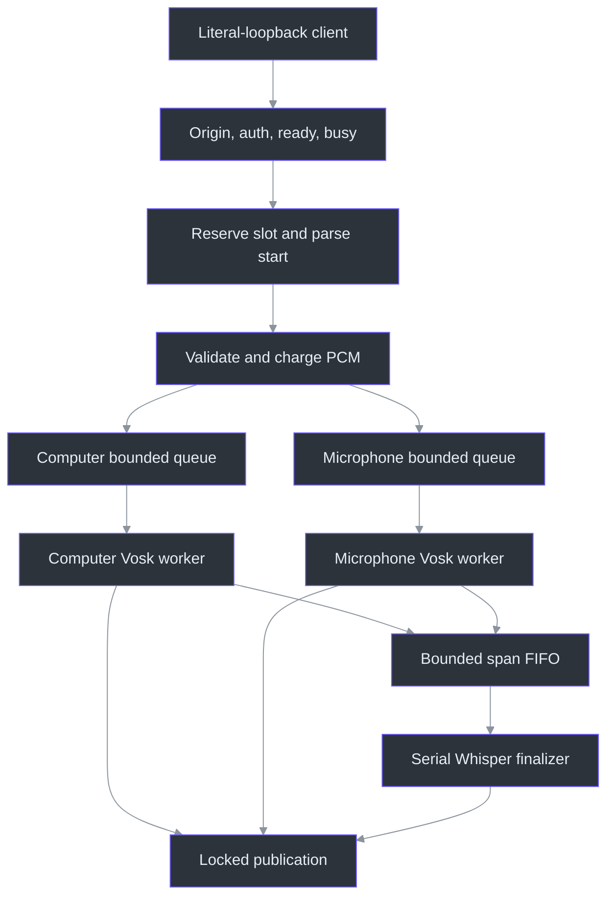
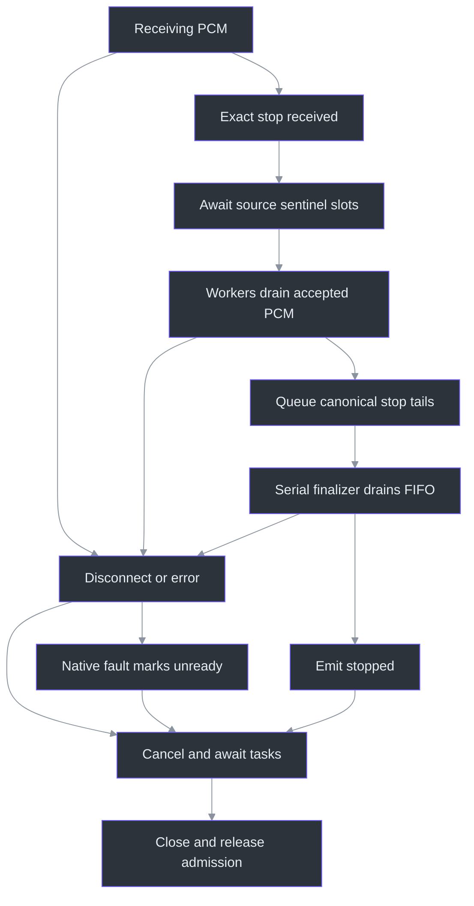

# Speech source walkthrough

## 1. Why this pipeline has two recognizers

Fast feedback and trustworthy final ownership are different problems. The default configuration selects **Vosk provisional text plus Whisper small.en CPU-int8 finals**, four threads and general technical vocabulary. Vosk supplies provisional hypotheses and endpoint decisions; Whisper recognizes the actual retained PCM span, not a spelling correction of Vosk text. This avoids treating a fast guess as evidence of what was spoken while retaining interactive feedback. The optional `vosk` engine and `base.en` model are explicit selections, not failure fallbacks. (services/transcription/configuration.py:13) (services/transcription/accurate.py:48) (services/transcription/accurate.py:101)

This chapter accompanies contiguous annotations for **23 files / 3,632 physical lines**, including dependencies, manifests, Docker and synthetic wrappers. Use the [full source atlas](../source-atlas/index.html) for complete source and focused excerpts, and its [reading guide](../source-atlas/README.md) for navigation. This is **source research**, not a new test result: no service, model, audio, management command, provisioner, Docker image or build was executed. External decoder internals, real devices and recipient-side capture remain separate assurance boundaries.

## 2. Admission: local transport is necessary but insufficient

The C# client validates the *original* endpoint spelling against literal `127.0.0.1` or `[::1]`, exact `/v1/transcribe`, a valid port, and no query, credentials or fragment. It disables proxies and redirects before adding the configured local authentication header. It waits for `ready` before accepting audio. Python's native manager uses literal IPv4 loopback; the server itself also permits `0.0.0.0` for container use, so “server always enforces loopback” would be false. (src/PhantomFudge.App/Audio/TranscriptionSocket.cs:27) (src/PhantomFudge.App/Audio/TranscriptionSocket.cs:82) (src/PhantomFudge.App/Audio/TranscriptionSocket.cs:144) (services/transcription/manage.py:189) (services/transcription/server.py:698)

`transcribe` checks, in order: nonempty Origin, authentication, query/body, model readiness, then existing activity. Authentication requires exactly one authorization header with the expected scheme and configured secret, compared using `hmac.compare_digest`. A token in a URL is not supported. Origin rejection is specifically nonempty values; HTTP normalization can make whitespace-only headers empty. (services/transcription/server.py:210) (services/transcription/server.py:538) (services/transcription/tests/test_protocol.py:96)

The consequential admission boundary is:

```python
if runtime.active:
    return web.json_response(error("busy"), status=409, headers=headers)
# No await separates admission from reservation, including the start handshake.
runtime.active = True
```

Within this event-loop handler, no task can interleave between the check and reservation. The reservation therefore includes the WebSocket upgrade and five-second start-message wait, not merely active PCM processing. Invalid startup cannot create two simultaneous sessions. `ready` is sent only after every selected decoder constructor succeeds. (services/transcription/server.py:549) (services/transcription/server.py:563)



The diagram describes **hybrid** execution. Legacy Vosk shares one queue and one CPU thread across source decoders; independent data state does not imply independent scheduling in that branch. (services/transcription/server.py:394) (services/transcription/server.py:429)

## 3. Strict v1/v2 framing and the units behind the bounds

`parse_start` compares decoded objects with exact allowed shapes. Explicit integer checks prevent Python's `True == 1` and `16000.0 == 16000` behavior from admitting those substitutes. This is strict object/schema validation, not a claim that the JSON parser rejects duplicate object keys. (services/transcription/server.py:88)

| Contract | v1 | v2 |
|---|---|---|
| Start | `type` plus the three format fields | Also integer `protocolVersion: 2` and canonical nonempty `sources` |
| Sources | Computer only | Computer, microphone, or computer then microphone |
| Binary message | Raw PCM | One byte: computer `1` / microphone `2`, then PCM |
| Partial/final labels | No `source` | Required `source` |
| Stop | Exact `{"type":"stop"}` | Same; no per-source stop extension |

Extra v1 `protocolVersion:1`, reversed dual sources, duplicate sources, undeclared prefixes, empty PCM, odd byte lengths and PCM over 32,000 bytes fail. Compression is disabled. Slight excess can receive `bad_frame`; gross oversize reaches aiohttp's hard transport ceiling and close `1009`. (services/transcription/server.py:100) (services/transcription/server.py:306) (services/transcription/server.py:321) (services/transcription/tests/test_dual_protocol.py:257)

The cross-language boundary is bytes, not a runtime-specific audio object:

```csharp
int prefix = _protocolVersion == 2 ? 1 : 0;
byte[] copy = new byte[pcm.Length + prefix];
if (prefix != 0)
    copy[0] = (byte)source;
pcm.CopyTo(copy.AsSpan(prefix));
```

The C# producer copies PCM into owned transport storage; Python strips exactly that prefix before applying audio budgets. Prefix bytes cannot inflate duration or consume another track's allowance. (src/PhantomFudge.App/Audio/TranscriptionSocket.cs:217) (services/transcription/server.py:321)

At 16,000 samples/second and two bytes/sample, **32 bytes is one millisecond**. The resource policy follows those units:

| Resource | Default and rationale |
|---|---|
| Incoming PCM frame | 32,000 bytes: at most one second |
| Waiting PCM per source | 64,000 bytes and 32 frames: both byte and tiny-frame pressure bounded |
| Per-source arrival credits | 64,000-byte / 200-frame burst; refill 32,000 bytes / 100 frames per second |
| Source duration | 28,800 seconds of received PCM, not an eight-hour wall timer |
| Native deadlines | Five seconds provisional/legacy; twenty seconds accurate final |
| Outstanding accurate work | Two spans per source, including the executing final |
| Individual span | Fifteen-second target; 512,000-byte cap allows a crossing frame |

The aggregate input cap scales only with declared source count. One busy computer track cannot borrow microphone slots. Queue counters decrease before decode, so they exclude the executing call; retained and pending spans have separate bounds. Overflow terminates with an explicit error rather than silently omitting audio or spawning unbounded tasks. (services/transcription/server.py:45) (services/transcription/server.py:332) (services/transcription/server.py:429) (services/transcription/server.py:453)

## 4. From provisional hypotheses to source-owned finals

`VoskFactory` verifies the model before passing an explicit `model_path`, avoiding name/language discovery that may download. The model is shared; each recognizer owns decoder state and sample counters. Legacy recognition rotates native history every thirty seconds and offsets/clamps word times into the source clock. (services/transcription/recognizer.py:41) (services/transcription/recognizer.py:69)

Hybrid ownership instead cuts **disjoint PCM spans**:

```python
end = self._start + len(self._pcm) // 2
result = FinalSpan(bytes(self._pcm), self._start, end, reason)
self._start = end
self._pcm.clear()
return result
```

Integer division converts even PCM bytes to samples; copying into immutable bytes freezes the finalizer's input. Advancing the cursor before clearing makes adjacent spans contiguous. At a Vosk endpoint or fifteen-second rotation, a new provisional decoder starts; no PCM is replayed. `finish` is one-shot and takes the exact remaining tail, even empty, without turning Vosk's final text into the accurate answer. (services/transcription/accurate.py:41) (services/transcription/accurate.py:57) (services/transcription/accurate.py:65)

`WhisperFinalizer` verifies a local pinned directory and constructs CPU-int8 inference with `num_workers=1` and `local_files_only=True`. Signed little-endian int16 becomes float32 divided by 32,768. Empty audio and peak magnitude below `0.001` return empty finals without inference; this is a near-digital-silence guard, **not** proof that other audio contains speech. (services/transcription/accurate.py:75) (services/transcription/accurate.py:93)

The call selects English transcription, beam size five, temperature zero, VAD with 400-ms silence and 200-ms padding, and explicit decoder thresholds. It disables previous-text conditioning and initial prompts. Optional hotwords come from 29 committed general technical terms—not reference sentences, user transcripts or a substitution dictionary. The reader consumes `terms`; the vocabulary's schema/description are descriptive rather than independently validated. (services/transcription/accurate.py:101) (services/transcription/technical-vocabulary.json:2)

Whisper returns a lazy segment iterable: iteration can still fail. The adapter validates string text, finite segment times and bounded accumulated text, then publishes **the input span's start/end**, not forced-aligned word timestamps. Consequently “exact source ownership” must not be presented as exact word alignment. (services/transcription/accurate.py:109)

One accurate FIFO and one final executor serialize Whisper across both sources. Provisional workers continue independently. While a source has earlier finals pending, only its latest validated provisional is retained; publication waits until those finals finish. A common lock serializes global segment IDs and wire ordering, while each source retains its own time and duplicate-partial state. Empty finals still consume an ID. V2 millisecond rounding is clamped down to submitted duration for submillisecond tails. (services/transcription/server.py:361) (services/transcription/server.py:445) (services/transcription/server.py:477)

For readers thinking in JavaScript, this is **explanatory pseudocode, not a repository implementation**:

```javascript
// Conceptual translation of one Python source's ordering rule.
latestPartial = validatedPartial;
if (pendingFinals === 0) publish(latestPartial);
// After the earlier accurate final has actually been published:
pendingFinals -= 1;
if (pendingFinals === 0 && latestPartial !== null) publish(latestPartial);
```

The omitted production details matter: Python also clears stale deferred text when a new span is queued, validates sizes before retention, and holds `publish_lock`. Creating one promise per frame would not reproduce its bounded worker model. (services/transcription/server.py:445) (services/transcription/server.py:468) (services/transcription/server.py:490)

## 5. Stop means drain, not disconnect

C# stops accepting new input, completes its queue, sends all queued frames and only then sends stop. Python records `stop_requested_at` and **awaits** queue capacity to insert sentinels. `put_nowait` here would incorrectly reject an otherwise valid full queue. Each hybrid source finishes after its own accepted frames; collected tails are queued in canonical source order, after earlier endpoint work. The finalizer emits `stopped` only after processing the final sentinel. Disconnect instead abandons the drain promise. (src/PhantomFudge.App/Audio/TranscriptionSocket.cs:258) (src/PhantomFudge.App/Audio/TranscriptionSocket.cs:322) (services/transcription/server.py:306) (services/transcription/server.py:394) (services/transcription/server.py:477)



During live input, excess final work faults; after stop, `queue_final` waits for a final slot because no producer can keep adding input. The supervisor applies a sixty-second budget based on the recorded stop clock **after `receive` returns from inserting sentinels**. It is not a separately armed timeout at first observation of stop. Cleanup and native-call waits add distinct timing boundaries; authenticated runtime advertises a default composite `maxStopSeconds` of 85, while C# defaults to a ninety-second flush timeout. These are configured limits, not latency measurements. (services/transcription/server.py:457) (services/transcription/server.py:500) (services/transcription/server.py:241) (src/PhantomFudge.App/Audio/TranscriptionSocket.cs:73)

Native calls cannot safely be killed. `_cpu` shields the executor future, marks the runtime failed on timeout/exception, observes eventual errors and prevents further admission. Cancellation attempts another bounded wait; executor cleanup uses `wait=False`. Neither task cancellation nor clearing queued references proves native termination or secure PCM erasure. A decoder failure never authorizes claiming a clean `stopped`. (services/transcription/server.py:161) (services/transcription/server.py:578) (services/transcription/server.py:629)

## 6. Configuration identity and actual manager ownership

The five configuration fields have distinct consumers:

| Field | Meaning and constraint |
|---|---|
| `schemaVersion` | Exact integer `1`; rejects an incompatible shape |
| `engine` | `hybrid-whisper` or explicit `vosk`; selects factory |
| `model` | `small.en` or `base.en`; selects pinned Whisper directory/revision |
| `threads` | Exact integer 1–8; passed to Whisper CPU construction |
| `vocabulary` | `technical` or `none`; controls hotwords and conditional vocabulary hash |

Only missing vocabulary is backfilled; otherwise exact keys are required. `PHANTOM_TRANSCRIPTION_ENGINE` overrides selection before validation. Even Vosk mode validates the model selector, although its reported model is Vosk 0.15. (services/transcription/configuration.py:18) (services/transcription/configuration.py:39)

`configFingerprint` hashes sorted compact identity JSON containing pipeline version, effective model/revision, compute type, threads/vocabulary and `runtimeRevision`. The latter hashes nine named source/dependency/manifest files with filename separators. Technical vocabulary is separately hashed when selected. **This is not a hash of the whole repository:** manager, Docker and healthcheck are excluded. Changing unused Whisper name in Vosk mode does not change its effective model identity. (services/transcription/configuration.py:39)

`manage.py` does not adopt a process because its PID or port looks familiar. It requires a local receipt, authenticated `/v1/runtime`, service name, management protocol `1` and matching canonical instance ID. PID is retained metadata, not kill authority. Management requests disable proxies/redirects and cap response bytes. The Windows one-byte lifecycle lock coordinates manager calls, not arbitrary programs racing for the port. (services/transcription/manage.py:45) (services/transcription/manage.py:67) (services/transcription/manage.py:95)

Reuse/upgrade follows this order:

1. Matching ready protocol/fingerprint: reuse, even if currently active.
2. Stale but active or activity unknown: refuse replacement.
3. Stale and explicitly idle: verify new model/dependency prerequisites **before** requesting shutdown.
4. New launch: write instance receipt first, pass explicit paths and offline flags, spawn detached, then authenticate readiness/protocol/fingerprint.
5. Unreachable existing receipt or ambiguous startup: retain the receipt; do not overwrite it or spawn again.

These orderings preserve a healthy old idle service when new provisioning is missing. Startup allows 45 seconds; owned idle shutdown allows twelve seconds for the port to close before deleting its receipt. No OS process-kill fallback exists. (services/transcription/manage.py:136) (services/transcription/manage.py:162) (services/transcription/manage.py:209)

## 7. Pinned provisioning, diagnostics and the optional container

`model.json` describes Vosk identity/license/catalogue and the explicit ZIP URL, byte length, archive hash and fourteen extracted-file hashes. Setup validates the archive before extraction; runtime verifies the exact regular-file set, links and every digest. Empty extra directories are not regular-file mismatches. `whisper-models.json` instead specifies repository, immutable revision, directory and exact sizes/hashes for four files per model. Both manifests explicitly distinguish pinned bytes from publisher-signed checksums. (services/transcription/model.json:2) (scripts/Initialize-Transcription.ps1:78) (services/transcription/recognizer.py:22) (services/transcription/whisper-models.json:2)

The Whisper provisioner prefers valid installed files, then verified benchmark-cache copies. Network access requires explicit `download=True`; exclusive `.partial` creation, exact-size reads, digest checks and replacement precede success. Existing invalid targets require deliberate removal. Its normal urllib downloader is **not** the manager's redirect/proxy-rejecting client. Contrary to the opening docstring, runtime modules do import its verification helpers; import does not call provisioning. (services/transcription/provision_whisper.py:15) (services/transcription/provision_whisper.py:38) (services/transcription/provision_whisper.py:58)

`requirements.txt` pins 35 package entries, with Windows-only colorama, but contains no wheel hashes. Native setup fingerprints that file and invokes pip consistency checks; runtime identity also includes its bytes. Package installation, model provisioning and local-files-only inference are three separate claims. (services/transcription/requirements.txt:1) (services/transcription/requirements.txt:21) (scripts/Initialize-Transcription.ps1:119)

Diagnostics accepts only fixed events/sources/faults and seven finite nonnegative numeric counters; arbitrary transcript fields or exception strings raise schema errors. JSONL rotates at one MiB with three backups under a process lock. An I/O failure latches `failed`, returns false and attempts a generic notice; even broken/closed stderr is contained. Authenticated runtime exposes logging loss without declaring recognition unavailable. These bounds concern this metadata logger, not the manager's separate generic output file. (services/transcription/diagnostics.py:13) (services/transcription/diagnostics.py:35) (services/transcription/diagnostics.py:59) (services/transcription/server.py:233)

The Dockerfile is an **optional legacy-Vosk recipe**, not native hybrid parity. It pins the Python base digest, installs the complete requirements, runs UID/GID 10001 and expects mounted Vosk/token inputs. It explicitly sets engine `vosk`; no Whisper weights are copied. Its internal `0.0.0.0` listener depends on Compose's host-loopback publication. No writable diagnostics directory is created for the nonroot/read-only arrangement, so logging availability cannot be assumed. Its healthcheck only compares exact public readiness JSON; it does not prove model quality, engine selection or manager ownership. (services/transcription/Dockerfile:1) (services/transcription/Dockerfile:14) (compose.yaml:8) (services/transcription/healthcheck.py:6)

## 8. What the tests actually arrange and prove

These are source-level assertions, not executions performed for this chapter:

| File | Arrangement, assertion and limit |
|---|---|
| `test_protocol.py` | Fake sample-counting decoder + ephemeral server: exact v1, pre-start busy, auth/Origin, frame/rate/time limits, generic native failure. The digest spy proves API use, not a timing measurement. (services/transcription/tests/test_protocol.py:64) |
| `test_dual_protocol.py` | Distinct PCM markers and scripted outputs prove source isolation, global IDs, source clocks, strict shapes and legacy one-thread dispatch. MemorySocket plus patched time isolates credit arithmetic and full-queue stop. (services/transcription/tests/test_dual_protocol.py:150) (services/transcription/tests/test_dual_protocol.py:380) |
| `test_recognizer.py` | Vosk-shaped fake forces thirty-second rotation, offsets and independent decoder state; no real acoustics. (services/transcription/tests/test_recognizer.py:38) |
| `test_accurate.py` | Distinct byte spans prove exact concatenation; gates demonstrate independent provisional workers, serial-final pressure, deferred partials and stop drain. Model stubs inspect options and lazy failures, not Whisper quality. (services/transcription/tests/test_accurate.py:43) (services/transcription/tests/test_accurate.py:279) |
| `test_management.py` | Synthetic instance and an Event callback test auth, idle shutdown and active refusal; mocked requests test receipt/redirect rejection, not Windows process launch. (services/transcription/tests/test_management.py:27) (services/transcription/tests/test_management.py:126) |
| `test_diagnostics_failure.py` | A file occupying the would-be log directory plus broken print/closed stderr must return false and retain failed state. This is direct logger containment, not end-to-end speech inference. (services/transcription/tests/test_diagnostics_failure.py:13) |

The hybrid suite also changes source bytes through a **patched read**, checks configuration fingerprints, and mocks lifecycle operations to assert “verify before stop,” no active replacement and no duplicate spawn behind an unreachable receipt. Diagnostic cases reject content fields, check rotation, and ensure failed hybrid loading never invokes the legacy factory. (services/transcription/tests/test_accurate.py:399) (services/transcription/tests/test_accurate.py:435) (services/transcription/tests/test_accurate.py:503)

The opt-in real-model wrappers differ materially:

- `Test-SyntheticTranscription.ps1` synthesizes a fixed David-voice phrase into memory, uses the **existing service and real local token**, and optionally builds/runs the C# transport harness. `real_model_check.py` asserts expected exact whitespace-token keywords, nonempty partials, IDs/tail order and a second silence session; it does not assert the service's selected engine. (services/transcription/Test-SyntheticTranscription.ps1:19) (services/transcription/tests/real_model_check.py:16) (services/transcription/tests/real_model_check.py:49)
- `tests/Test-DualSyntheticTranscription.ps1` creates two distinct in-memory phrases plus one second of silence each. `real_dual_model_check.py` uses a **cached real Vosk model, synthetic token and ephemeral server**. It asserts shared-model/distinct-decoder identities, exact event shapes, no opposite-track keywords, timing and fresh v2-microphone/v1 silence sessions. It is not a real hybrid or microphone-device test. (services/transcription/tests/Test-DualSyntheticTranscription.ps1:21) (services/transcription/tests/real_dual_model_check.py:50) (services/transcription/tests/real_dual_model_check.py:99)

Their “passed” output strings are conditional program output, not evidence produced by reading them. Synthetic speech cannot establish accent/noise/general accuracy, device-loss handling, real-time performance on arbitrary hardware or capture exclusion. Mechanical line coverage likewise cannot prove every subtle behavior has been understood; full annotations preserve the exact blocks and limitations for subsequent review.
