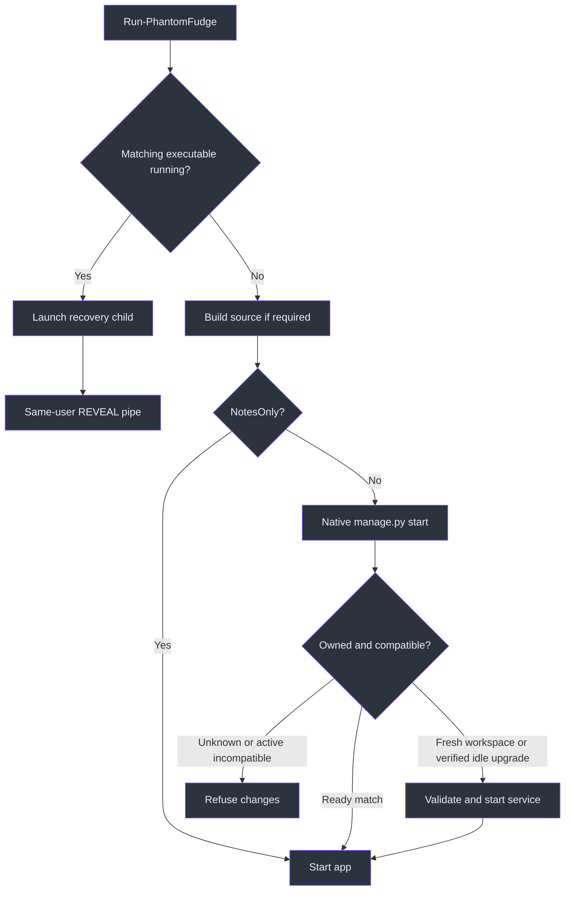
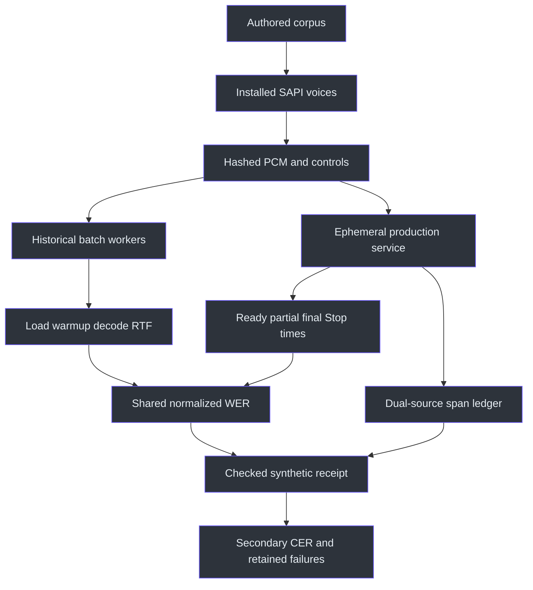

# Operations source walkthrough

## Why these helpers are separate

An operational helper must distinguish **permission to prepare** from permission to record, authenticate, infer, export, or publish. Here, transcription setup writes verified assets and settings; startup delegates to an authenticated local manager; playback has its own explicit consent switch; answer sign-in is separate from question submission. Collapsing these into “run setup” would conceal materially different side effects. (scripts/Initialize-Transcription.ps1:147) (scripts/Start-Transcription.ps1:8) (scripts/Test-PlaybackTranscription.ps1:8) (scripts/Initialize-Answers.ps1:62)

This chapter accompanies **31 canonical source/config/test files, 2,671 physical lines**, partitioned in the [operations annotations](../source-atlas/annotations/operations.json). Use the [source atlas](../source-atlas/index.html) for complete source and focused excerpts, and its [reading guide](../source-atlas/README.md) for navigation. This delivery is source research only: no script, model, probe, test, build, authentication, network request, audio endpoint, or Docker action was executed. Historical result files are evidence boundaries, not newly reproduced measurements.

## 1. Setup is a sequence of separate commitments

### Verified assets are not an unrestricted download permission

`Initialize-Transcription.ps1` defaults to hybrid Whisper, `small.en`, technical vocabulary and, ultimately, four inference threads. It first verifies Vosk by manifest file count, descendant reparse-point checks, required names and SHA256 values. A missing extracted model can be reconstructed from an already cached, byte/hash-verified ZIP **without** `-DownloadModel`. An invalid existing directory or cached archive is refused rather than overwritten. Only an absent archive permits an explicitly authorized download into `.partial`, followed by verification and rename. (scripts/Initialize-Transcription.ps1:2) (scripts/Initialize-Transcription.ps1:26) (scripts/Initialize-Transcription.ps1:78)

The token is another commitment: create 32 random bytes only when absent, encode them as hex, write with `CreateNew`, restrict the Windows DACL to the current SID, and reject invalid existing values instead of silently rotating credentials. Clearing managed variables is not secure erasure. Setup can create this token before a later model failure, so the procedure is staged, not globally transactional. (scripts/Initialize-Transcription.ps1:42)

**“No model download” does not mean “no network.”** Unless skipped, Python setup can create a venv, invoke pip and check dependencies. A requirements-file hash receipt plus three import checks decides whether restoration is needed; it is not a full installed-package integrity audit. `-SkipPythonSetup` skips that stage, not Whisper verification. Hybrid provisioning then uses the local interpreter, or host Python if absent, and forwards `--download` only when selected. The Python provisioner first accepts valid installed files or a verified benchmark cache; existing bad files require explicit repair. (scripts/Initialize-Transcription.ps1:119) (scripts/Initialize-Transcription.ps1:147) (services/transcription/provision_whisper.py:47)

The final configuration is written through `.new` and moved into place only after those stages succeed. Production loading checks an exact key set and validates engine, model, vocabulary and thread bounds. Selecting Vosk is explicit legacy behavior, not automatic rescue after Whisper fails. (scripts/Initialize-Transcription.ps1:157) (services/transcription/configuration.py:17)

### Recovery precedes build and service management

The diagram follows the launcher and its manager dependency; “ready” never means capture has started. (scripts/Run-PhantomFudge.ps1:17) (services/transcription/manage.py:203)



The existing-instance branch filters by executable path and launches a recovery child; it does not kill the first process or report confirmed restoration. `App.OnStartup` dispatches the child to `SingleInstance.RevealExistingAsync`, which sends only six-byte `REVEAL` through a current-user-only pipe. The first instance schedules its reveal/reset operation on the dispatcher. `-PassThru` returns the recovery child on this branch, not the original app. (scripts/Run-PhantomFudge.ps1:17) (src/PhantomFudge.App/App.xaml.cs:62) (src/PhantomFudge.App/Native/SingleInstance.cs:28)

For a new launch, packaged executables bypass source builds. `-NotesOnly` skips service startup; it is **not** a privacy sandbox or permanent capture prohibition. The launcher still supplies an available token and the fixed loopback URI to the child. (scripts/Run-PhantomFudge.ps1:29) (scripts/Run-PhantomFudge.ps1:43)

Service ownership is stronger than “a PID exists.” `manage.py` locks lifecycle changes, combines the local receipt with authenticated service/instance identity, and checks protocol support plus a configuration fingerprint containing runtime-source hashes. An incompatible active service is refused. Replacement assets are validated **before** shutting down an owned idle service. With no listener, a stale receipt is removed only after process inspection confirms death or PID reuse; live/unknown ownership is retained rather than overwritten. Shutdown uses an instance-bound authenticated request and requires `active=false`; it does not terminate an unrelated OS process. (services/transcription/manage.py:66) (services/transcription/manage.py:155) (services/transcription/manage.py:186) (services/transcription/manage.py:215) (services/transcription/configuration.py:38)

Docker is an explicit alternative branch requiring existing recipes, engine and Compose. It is neither installed nor selected as fallback. Its `compose down` path does not inherit the native manager’s idle/identity protocol, so the two stop modes should not be described as equivalent safeguards. (scripts/Start-Transcription.ps1:18) (scripts/Stop-Transcription.ps1:8)

## 2. Answer preparation, authentication, and probe isolation

`Initialize-Answers.ps1` requires an explicit provider. `SnapshotOnly` avoids executable preparation; the other modes invoke app preparation entry points and validate their returned installed executable. A 30-second preparation timeout kills only the owned child tree. The app writes a receipt and exits before ordinary window startup. Configuration subsequently moves from a temporary file to per-user `answers.json`; the runtime reader rejects oversized or unmapped settings. (scripts/Initialize-Answers.ps1:29) (scripts/Initialize-Answers.ps1:44) (src/PhantomFudge.App/App.xaml.cs:18) (src/PhantomFudge.Core/Answers/AnswerConfiguration.cs:15)

`LocalModel` requires an identifier and literal HTTP loopback `/v1` endpoint, not a hostname selected implicitly. That regex is only the first gate: its one-to-five-digit port shape is not numeric TCP-port validation. `-Connect` is Copilot-only and explicitly runs login in the dedicated profile, after scrubbing named inherited environment families. Unlike preparation, login has no scripted timeout. Failed login prevents enabling new settings but does not undo preparation/profile side effects. No question is submitted here; installed CLI execution must not be equated with offline inference. (scripts/Initialize-Answers.ps1:11) (scripts/Initialize-Answers.ps1:62)

The desktop preserves the downstream distinction: ordinary Ask has no clarification history; `clarifyFirst` begins false, and a correction or Yes requires explicit submission. A typed correction is not discarded by clicking confirmation. Direct Azure remains future work. Preview 2 includes selection/clarification and Previous answer; Preview 1 lacks the latter and the historical `045022` ZIP predates both. (src/PhantomFudge.App/MainWindow.Clarification.cs:11) (src/PhantomFudge.App/MainWindow.Clarification.cs:120) (docs/OVERVIEW.md:131-134)

The two CopilotProbe files are **active experiments**, not passive configuration readers:

| Helper | What source actually arranges | Limit |
| --- | --- | --- |
| `agency_profile_probe.py` | Unique home, empty plugin selection, restricted environment, version and `config check --skip-remotes` calls | Hard-coded local installation; module-level execution; prints exit results rather than asserting success |
| `probe.py` | Two ephemeral loopback HTTP servers, isolated CLI home, attachment/home sentinels, SSE/error/tool/truncation/redirect cases | Observes installed-CLI behavior; settings and flags are not an OS sandbox |

The protocol probe stores only authorization presence, not its value, but records synthetic user messages. Its timeout terminates the owned PID tree; `--keep` retains receipts. Cleanup is not wrapped around every possible startup/write failure. Neither helper was executed for this chapter. (tools/CopilotProbe/agency_profile_probe.py:9) (tools/CopilotProbe/agency_profile_probe.py:29) (tools/CopilotProbe/probe.py:76) (tools/CopilotProbe/probe.py:118) (tools/CopilotProbe/probe.py:135)

## 3. Packaging and visual evidence are allowlisted transformations

### Installer workstream58 is separate from the legacy ZIP

The new [installation chapter](../INSTALLATION.md) traces `Build-Installer.ps1`, the Inno recipe
and native launcher. It targets an unsigned Windows11 x64 prerelease with bundled speech
runtime/models, per-user installation and guarded update/uninstall. The clean-source prerelease
is published with exact asset identities and bounded installer evidence. See
[current evidence](../IMPLEMENTATION-STATUS.md).
Private repository access, retained external data and separate provider setup remain explicit.
The self-contained publish/asset recipe is not a passing installer lifecycle receipt.
(scripts/Build-Installer.ps1:30-54,56-114)
(tools/Installer/PhantomFudge.iss:14-76,107-161)
(src/PhantomFudge.Launcher/Program.cs:25-100)

Compact launcher metadata and complete payload inventory are separate. The inventory omits its
own self-hash; hidden-entry/reparse/private-path checks happen before it is written. The installer
fixture uses an isolated random AppId/path, exact payload coverage/hashes and a simulated older
version record. Lifecycle3 passes 11 checks against 3,682 inventoried files from current-runtime
candidate2, including fresh-helper repair and headless layout validation. It omits shortcuts,
does not start the app/service and does not establish genuine old-binary migration or clean-VM
qualification. The build's separate real-PCM gate requires natural process exit.
(scripts/Build-Installer.ps1:56-98)
(scripts/Build-Installer.ps1:30-34)
(scripts/Test-Installer.ps1:15-18,40-84,96-104)
(src/PhantomFudge.Launcher/Program.cs:25-43,94-100)

The runtime bundler pins embedded CPython3.13.14, discloses PCM-only
`faster-whisper 1.2.1+phantomfudge1` and rebuilds `CTranslate2 4.6.0+phantomfudge2` with
oneDNN3.1.1/Microsoft compiler OpenMP. It retains package/native notices, including the explicit
PyAV omission rationale, rather than copying private environments or providers. Its import probe
labels closure as modified installed metadata only. The separate `--verify-synthetic-pcm` gate,
required by `Build-Installer.ps1`, runs real hybrid/VAD/forced Whisper computation and requires
natural exit. The parent confirms85focused tests; the owner reports successful Unicode execution;
the Vosk package is unmodified and a first-party working-directory adapter handles non-ASCII paths.
Earlier Ruy stages remain rejected. Neither this generated-PCM result nor older development speech
measurements qualifies real captured-speech accuracy, new-backend performance or a clean VM.
(tools/Installer/runtime-lock.json:1-11)
(tools/Installer/bundle_runtime.py:246-282,332-376,465-535,538-609,682-694)
(scripts/Build-Installer.ps1:30-34)
(services/transcription/recognizer.py:47-77)
(services/transcription/tests/test_packaged_pcm_runtime.py:35-97,126-138)

`bundle` now unconditionally runs `runtime_audit.audit_pe_closure` before imports, storing the
auditor's source hash and native dependency records in the manifest. The static check resolves
declared ordinary/delay/forwarder DLL names only against reviewed inbox names or supported bundled
locations; the shared probe separately requires the five VC runtime DLLs beside Python. This
closes the evidentiary gap left by merely restricting `PATH`. The parent reports 92 speech PE
files/five actual bundled CRT paths passing and a separate 861-file app/launcher static pass.
The final DLL-qualified runtime rebuild now passes the stronger gate; the parent also confirms85
focused runtime tests and55native tests passing again. Candidate2's functional DLLs are unchanged;
these are not clean-VM or comprehensive dynamic-loading results.
(tools/Installer/bundle_runtime.py:45,677-694)
(tools/Installer/runtime_audit.py:126-166,169-234)

Setup never starts the app; users finish/close it and then launch from Start. The launcher does
not release its operation mutex merely because a child survived a delay: it waits for the main
app mutex or confirmed child exit, reports pending76after30seconds, and preserves the guard
when pending Close hides progress or the dispatcher shuts down. Its status/error surface is
ordinary visible UI, not the capture-excluded notes HWND.
(tools/Installer/PhantomFudge.iss:14-76)
(src/PhantomFudge.Launcher/Program.cs:108-118,186-227)
(src/PhantomFudge.Launcher/LauncherWindow.cs:18-57)

### Historical development package

`Publish-Preview.ps1` creates a new timestamped, self-contained .NET `win-x64` directory, refuses collisions, and rejects nonzero publish status before compression. Supplementary content is explicit: nine guides, eight script names, eleven speech runtime/configuration files and five selected historical result files. It does not recursively copy `.local`, tokens, venvs, model caches or probe directories. Self-contained .NET does not mean Python, voices, provider executables or models are bundled. (scripts/Publish-Preview.ps1:14) (scripts/Publish-Preview.ps1:27)

The script-mirror convention has an especially useful implementation:

```powershell
Copy-Item -LiteralPath $source -Destination $scripts
Copy-Item -LiteralPath $source -Destination (Join-Path $scripts "$name.txt")
```

Both outputs read the canonical `.ps1`, so packaged aliases derive from the same bytes rather than a second maintained implementation. This documentation annotates only canonical scripts; parent validation owns source-tree alias equality. ZIP hashing identifies bytes, not signing, publication or qualification. (scripts/Publish-Preview.ps1:30) (scripts/Publish-Preview.ps1:49)

Image export follows another evidence boundary. The screenshot helper builds a separate fixture, waits up to 45 seconds, and requires successful non-recording documentation output before importing its explicit PNG allowlist. It records image dimensions/hashes, selected UI-source hashes and assembly identity. The README helper requires exactly one matching source-hash record, composites selected images unscaled over fixed opaque palette backgrounds, and records both hashes. These loops are incremental, not transactional. Neither RenderTargetBitmap nor successful provenance checks establish recipient-side capture exclusion. (scripts/Export-HandbookScreenshots.ps1:12) (scripts/Export-HandbookScreenshots.ps1:26) (scripts/Export-HandbookScreenshots.ps1:79) (scripts/Export-ReadmeImages.ps1:29)

The previous-answer increment adds `answer-context.png` to both source and derivative allowlists,
and hashes the context controller plus its synthetic diagnostic in screenshot provenance. The
fake provider records requests and emits deterministic completion/failure/cancellation paths;
it checks toggle/keyboard/reset behavior and unchanged clarification snapshots without a real
model or audio device. Its screenshot is taken with generated text and an explicit synthetic notice.
Source implementation, executed fixture receipt and manual rendered review remain distinct evidence;
none is inferred merely from an image filename or test method.
([Context diagnostic](../../src/PhantomFudge.App/MainWindow.AnswerContextDiagnostics.cs),
[screenshot exporter](../../scripts/Export-HandbookScreenshots.ps1),
[README derivatives](../../scripts/Export-ReadmeImages.ps1),
[workstream59 evidence](../../TODO/59_PREVIOUS_ANSWER_CONTEXT.todo).)

## 4. Diagnostics: collection, summary, and export are different

`Set-Diagnostics.ps1` persists only `includeText`; the app must reload it. Metadata is default. Text mode retains final transcripts, submitted questions and answers locally in plaintext, not raw audio. Changing back does not erase old files. The producer restricts metadata values and content kinds before writing; the exporter is not the sole privacy control. (scripts/Set-Diagnostics.ps1:8) (src/PhantomFudge.Core/Diagnostics/LocalDiagnostics.cs:145) (src/PhantomFudge.Core/Diagnostics/LocalDiagnostics.cs:162)

`Export-Diagnostics.ps1` creates a timestamped local directory and projects records onto two field lists. App text is included only with the independent `-IncludeText`; backend fields never gain text:

```powershell
$safe = [ordered]@{}
foreach ($key in $keys) {
    if ($record.PSObject.Properties.Name -contains $key) { $safe[$key] = $record.$key }
}
```

The empty destination object is important: unknown top-level fields cannot survive by accident. However, values under accepted keys are copied, not recursively anonymized. File-level reparse checks and shared ReadWrite/Delete access support reading active/rotating logs; malformed JSON is counted, while strict UTF-8 or other I/O errors can still abort. The manifest reports separate app/backend counts, skipped lines, requested text inclusion and `uploaded=false`. No upload operation appears. (scripts/Export-Diagnostics.ps1:19) (scripts/Export-Diagnostics.ps1:34) (scripts/Export-Diagnostics.ps1:43) (scripts/Export-Diagnostics.ps1:73)

`Show-Diagnostics.ps1` selects recent `AnswerStarted` records with `user_ask` by default, joins by correlation ID and separates app-received text, UI-visible text and terminal time. It never displays Text. Missing/rotated records remain missing, not zero; first-event selection uses encounter order, while terminal selection uses UTC order. Text-mode content records can also carry `AnswerCompleted` without elapsed time, so this summary is not an infallible latency ledger. (scripts/Show-Diagnostics.ps1:26) (src/PhantomFudge.Core/Diagnostics/LocalDiagnostics.cs:179)

## 5. Synthetic corpus design and comparable inputs

The historical corpus has eight ordinary/technical/numeric sentences; the quality corpus combines the requested two-sum phrase, four technical variations and three unrelated/homophone controls. Quality generation requires two installed en-US voices; the older benchmark accepts one or two. Neither installs voice packs. System.Speech synthesizes into memory and raw PCM files, never a speaker destination in this path. (tools/SpeechBench/corpus.json:2) (tools/SpeechBench/quality-corpus.json:2) (tools/SpeechBench/quality_regression.py:44) (tools/SpeechBench/SapiBridge.cs:53)

Both generators produce clean and deterministic 15 dB Gaussian-noise variants. At 16 kHz, mono int16 means **32,000 bytes/second**. Leading 4,000 samples equal 250 ms; trailing padding is one second historically and 1.5 seconds in quality runs. Noise amplitude is scaled by `speechRms / 10^(15/20) / measuredNoiseRms`, then samples are clipped and rounded. This is a controlled SNR construction, not a recording of real room noise. Quality additionally creates three-second digital silence, noise-only and tone-only cases with empty references. (tools/SpeechBench/bench.py:125) (tools/SpeechBench/quality_regression.py:62) (tools/SpeechBench/quality_regression.py:85)



These are related measurement concepts, **not one automatic pipeline**: `quality_receipt.main` consumes named quality/stress receipts, not historical `bench` output. Direct package versions are pinned, including `num2words` because normalization affects scores; quality adds `aiohttp`. These files are not complete transitive hash locks. Historical Whisper provisioning records observed post-download hashes for a pinned revision; production provisioning instead checks its checked-in file sizes/hashes and exact file set. Neither claims publisher signatures. (tools/SpeechBench/requirements.txt:1) (tools/SpeechBench/quality-requirements.txt:1) (tools/SpeechBench/bench.py:75) (services/transcription/whisper-models.json:4) (services/transcription/provision_whisper.py:37)

### Cross-language boundary: C# callbacks to Python results

`SapiBridge.Decode` attaches recognized/completed handlers before starting asynchronous file dictation, waits up to sixty seconds, requests cancellation on timeout and always detaches handlers/clears input. Python waits for the hosting PowerShell process, reads JSON and applies the common score. This explains why a subprocess exit alone is insufficient: the bridge can return `status=unavailable`. (tools/SpeechBench/SapiBridge.cs:75) (tools/SpeechBench/sapi.ps1:7) (tools/SpeechBench/bench.py:66)

**Explanatory C# → Python pseudocode, not production:**

```python
parts = []
subscribe_recognized(lambda text: parts.append(text))
subscribe_completed(lambda error: completion.signal(error))
try:
    start_file_dictation(wav_bytes)
    completion.wait_or_cancel(deadline_seconds=60)
    return " ".join(parts)
finally:
    unsubscribe_handlers()
    clear_input()
```

Subscription must precede start; waiting must include completion, not merely scheduling; cleanup must occur on failure as well as success. The actual C# also waits up to five seconds after cancellation and preserves the engine error. (tools/SpeechBench/SapiBridge.cs:89) (tools/SpeechBench/SapiBridge.cs:95)

## 6. WER, CER, and timing math

Normalization applies NFKC, lowercase, percent expansion, digit-to-English conversion, apostrophe removal and ASCII alphabetic token extraction. It does **not** remove stop words or repair model-specific mistakes. The dynamic program carries `(total, substitutions, deletions, insertions)` and chooses substitution, deletion, insertion in that order on equal total cost. WER is `(S+D+I)/referenceWords`, can exceed one, and is undefined for an empty reference while insertion errors remain. (tools/SpeechBench/metrics.py:16) (tools/SpeechBench/metrics.py:28)

Pooling must sum counts before dividing. **Explanatory Python → JavaScript pseudocode**, translating `aggregate`, not a replacement implementation:

```javascript
function pooledWer(rows) {
  const words = rows.reduce((sum, row) => sum + row.reference_words, 0);
  const edits = rows.reduce((sum, row) => sum + row.errors, 0);
  return words === 0 ? null : edits / words;
}
```

One error in a one-word case plus four correct words is `1/5`, not `(1+0)/2`. Empty-reference hallucinations still increase pooled errors. Secondary CER joins normalized words without spaces and computes character distance: `leet code`/`LeetCode` can have zero CER while retaining WER errors; `two sum`/`to some` cannot. Receipt tests include arbitrary compounds, spelling errors, empty-reference insertions and repeated phrases to guard this distinction. (tools/SpeechBench/metrics.py:58) (tools/SpeechBench/test_metrics.py:34) (tools/SpeechBench/quality_receipt.py:11) (tools/SpeechBench/test_quality_receipt.py:7)

| Quantity | Exact boundary and interpretive limit |
| --- | --- |
| Historical batch RTF | Median repeat-total decode seconds divided by total audio seconds; excludes load, warmup and paced experiments |
| Historical accuracy | Repeat zero only; later repeats report timing and changed hypotheses |
| Quality ready time | WebSocket connection/start/strict-ready interval, before stream clock starts |
| Speech-end-to-final | Last nonempty final wall time minus fixed clean last-active-sample time; paced rows only |
| Quality p95 | Sorted non-null values at `ceil(0.95*n)-1`; cold first row is retained |
| Stress Stop latency | Terminal stopped time minus sent-Stop time, only if Stop was sent and stopped acknowledged |

These definitions are implemented independently; batch throughput cannot establish conversational latency. Quality aggregation includes all repeats, unlike historical accuracy. (tools/SpeechBench/bench.py:257) (tools/SpeechBench/bench.py:354) (tools/SpeechBench/quality_regression.py:141) (tools/SpeechBench/quality_regression.py:182) (tools/SpeechBench/quality_regression.py:204) (tools/SpeechBench/quality_stress.py:188)

## 7. Long stress: byte correctness is not word correctness

The dual-source runner concatenates cropped clean Computer phrases twice and padded Mic phrases once. It sends 1,280-byte packets—40 ms—per source with a one-byte source tag. The shorter source ends earlier without mixing tracks. Forced-endpoint and temperature-fallback experiments are explicit modifications, not normal recovery behavior; current production rejects forced windows beyond its 15-second ceiling despite historical comments mentioning thirty seconds. (tools/SpeechBench/quality_stress.py:26) (tools/SpeechBench/quality_stress.py:38) (tools/SpeechBench/quality_stress.py:58) (tools/SpeechBench/quality_stress.py:146)

Each finalized span is mapped to its source, timed and fed into a running PCM hash. Validation combines contiguous start/end sample ranges, final cursor coverage and equal input/decoded hashes. `all_samples_owned_once` alone only compares the ending cursor; the conjunction matters. Final IDs must be exactly `1..N` globally. The receipt is written **before** assertions so faults remain evidence rather than disappearing. Exact sample ownership can coexist with wrong words. (tools/SpeechBench/quality_stress.py:112) (tools/SpeechBench/quality_stress.py:164) (tools/SpeechBench/quality_stress.py:199)

The compiler preserves rejected experiments and replaces invalid historical error-terminal “Stop latency” with null, retaining the old value under an explicitly unusable name. It checks identical case ordering/PCM/reference text, recomputed WER, faults/drops and a production setup fingerprint. Its hardware descriptions and historical interpretation are authored constants, not fresh discovery. The setup check itself validates one paced phrase and expected `LeetCode` spelling, not an entire accuracy suite. (tools/SpeechBench/quality_receipt.py:56) (tools/SpeechBench/quality_receipt.py:78) (tools/SpeechBench/quality_receipt.py:100) (tools/SpeechBench/quality_setup_check.py:60)

## 8. What the checks do—and do not—establish

| Check | Arrangement, stimulus, and assertion | Not established |
| --- | --- | --- |
| Harness guards | Mock WAV at 44.1 kHz, duplicate IDs, empty corpus and output escapes must fail | Real audio/model correctness |
| Metrics tests | Known normalization/edit/weighting examples | Multilingual or semantic accuracy |
| Native lifecycle | Own blank HWND; minimize/hide, relaunch, then close | Recipient capture exclusion or UX approval |
| Dual synthetic wrapper | Separate in-memory source phrases; Python/native harness exit status | Device routing, microphone echo or actual meeting quality |
| Playback wrapper | Explicit consent, synthetic PCM and expected phrase through real loopback harness | Isolation from unrelated output audio |

These limits follow the actual arrangements, not the filenames. (tools/SpeechBench/test_harness.py:9) (tools/SpeechBench/test_metrics.py:19) (scripts/Test-NativeLifecycle.ps1:69) (scripts/Test-DualSourceSynthetic.ps1:18) (scripts/Test-PlaybackTranscription.ps1:29)

Mechanical line coverage is not proof that every subtle behavior has been understood. External speech libraries, CLI versions, model correctness, real devices, live providers and recipient capture remain separate boundaries. This chapter’s diagrams were authored from source; rendering/compiler validation is reserved for the parent’s integration pass. Full source, focused snippets and per-block exceptions remain in the [atlas](../source-atlas/index.html), rather than duplicated as source dumps here.
