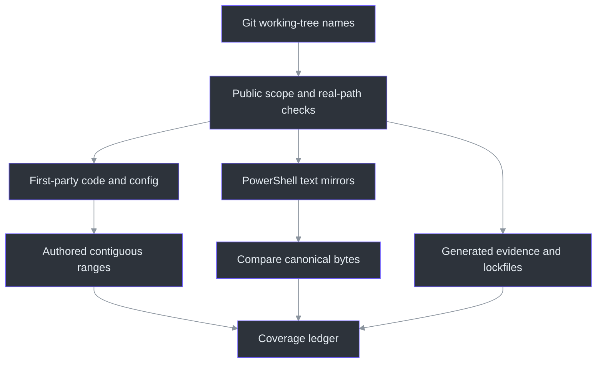
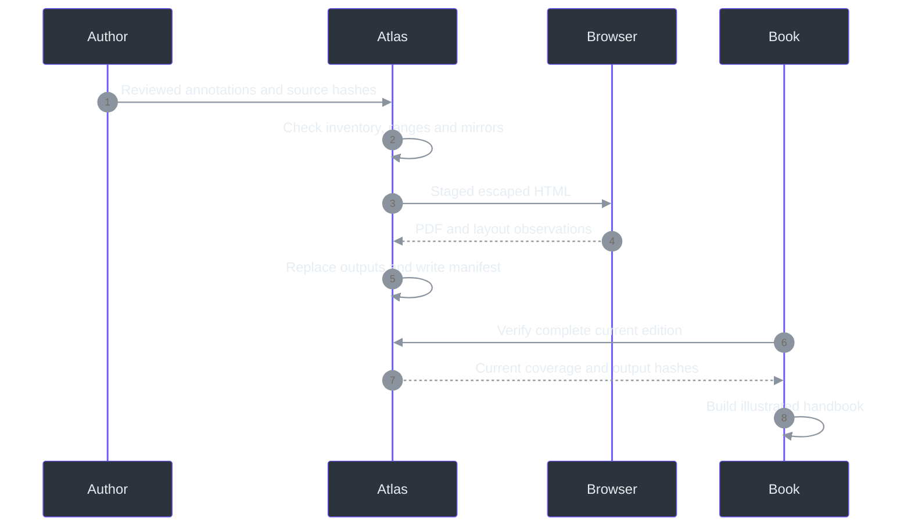

# 28 - Documentation Compiler and Root Configuration, Statement by Statement

## Why explanation needs its own integrity checks

The request for every interesting line creates two different obligations. First, the explanation
must actually interpret the program: what values mean, why a guard precedes a mutation, what a
failure preserves, and which layer owns an operation. Second, the documentation must expose what
was covered. A persuasive paragraph cannot demonstrate that an overlooked file was read.

The source atlas separates those obligations. Authored annotation groups explain contiguous
source ranges and choose consequential excerpts. A compiler checks the file inventory, exact
source bytes, partition boundaries and generated edition. The [searchable atlas](../source-atlas/index.html)
shows the complete source beside these explanations; its [coverage ledger](../source-atlas/coverage.json)
makes missing or stale work visible. The compiler does **not** claim to prove that each explanation
is correct. That remains a reading/review obligation.
([`validateFileAnnotation` and `loadAtlas`](../../tools/Docs/source-atlas.mjs).)

The main handbook supplies conceptual and end-to-end walkthroughs. The source atlas is the
per-file reference, including tests and operational tooling. Its PDF prints explanatory blocks
and selected excerpts, while the HTML also exposes every source line. Repeating twenty thousand
lines of source in the main book would create bulk without necessarily adding understanding.
The companion structure keeps code available without replacing explanation with a dump.
([`renderFile`, `makeHtml` and `main`](../../tools/Docs/source-atlas.mjs).)

## The first configuration statements already change behavior

`Directory.Build.props` applies common C# build policy to the projects beneath the repository
directory. `Nullable` enables nullable analysis; `ImplicitUsings` supplies SDK-selected imports;
`TreatWarningsAsErrors` promotes compiler warnings to build failures. These settings are not
runtime null guards and do not prove that every external value is validated. `Deterministic`
requests deterministic compilation, while `RestorePackagesWithLockFile` creates a dependency
resolution record. Reproducibility still depends on the actual SDK and inputs.
(Directory.Build.props:1-9.)

`global.json` supplies that SDK selection: version `10.0.112`, patch-level roll-forward and no
prerelease selection. The SDK is not the same thing as the deployed .NET Desktop Runtime.
`PhantomFudge.slnx` then groups the spike, application/Core and two test projects. A directory
appearing in the solution does not run it, and the source atlas does not run those projects while
reading them. The exact project references and launch scripts are explained in their own groups.
(global.json:1-7; PhantomFudge.slnx:1-13.)

The repository's ignore files answer different questions. `.gitignore` excludes ordinary working
artifacts such as private continuity, local models, dependency caches and build outputs from
untracked-file discovery. It does not retroactively untrack a previously committed file.
`.dockerignore` instead starts with `**` and reopens selected service paths: that is a build-context
allowlist, not a runtime filesystem rule. The source compiler applies its own public-path checks
rather than treating either ignore file as a universal privacy guarantee.
([`.gitignore`](../../.gitignore), [`.dockerignore`](../../.dockerignore),
[`readPublic`](../../tools/Docs/source-atlas.mjs).)

`compose.yaml` is an optional legacy-service recipe, not the normal architecture. The literal
`127.0.0.1` host binding limits the published host interface; `create_host_path: false` prevents
a mistyped model path from silently becoming a newly created empty directory. Read-only mounts,
all-capability dropping and `no-new-privileges` express separate container controls. The file
also sets CPU/memory/PID/file-descriptor limits, disables automatic restart and supplies a
15-second stop grace period. These declarations have not become qualified execution evidence
merely because they are documented. Native accurate recognition and its drain budget are separate.
(compose.yaml:1-48.)

## Inventory: distinguish source, mirrors and generated records

The compiler asks Git for cached and untracked, non-ignored names using a NUL-delimited result.
NUL separation avoids shell quoting assumptions about spaces in paths. The command is a metadata
read; it is not a fetch, push, repository search service or execution of source files. An 8-MiB
output bound prevents an unexpectedly large listing from being treated as an unbounded stream.
([`discoverSources`](../../tools/Docs/source-atlas.mjs).)

Classification is explicit. First-party C#, XAML, Python, JavaScript, PowerShell, CSS, project files,
requirements and selected JSON/configuration files are annotated. Build/cache directories are not.
Generated `results` records and dependency lockfiles are indexed with a different kind: their
existence and bytes are tracked, but the book does not pretend that every generated value received
statement-level interpretation. Root build/configuration inputs and the book catalogue are
explicit exceptions to the implementation-directory rule.
([`sourceKind`](../../tools/Docs/source-atlas.mjs).)

A PowerShell `.txt` twin receives a third treatment. It maps to its `.ps1` canonical source and
must be byte-identical. Annotating both copies would double the apparent coverage without explaining
additional logic. Failing the equality check is an actionable packaging/documentation drift error,
not permission to pick one version silently. Unrelated text files are not automatically assumed
to be executable mirrors.
([`discoverSources`](../../tools/Docs/source-atlas.mjs).)



### A path is validated twice for different reasons

Lexical validation prevents an annotation from naming `../outside.cs`, an absolute path, or
private directories. Real-path validation then resolves the filesystem target and refuses aliases
that would bypass the intended path. The existing handbook helper is reused for the repository
boundary. It rejects private context, `.local`, Git state, environment files and dependency caches.
This is a constrained local documentation reader, not an operating-system sandbox.
(tools/Docs/build.mjs:75-87; [`readPublic`](../../tools/Docs/source-atlas.mjs).)

A source hash is deliberately compared against the authored annotation, not merely regenerated
into a new manifest. If the source changes, the old explanation must fail before publication.
Updating `sourceSha256` without reading the new source would bypass the human part of the contract,
even though it could satisfy the mechanical check. Exact-byte hashes also detect line-ending
changes; they are edition fingerprints, not semantic equivalence proofs.
([`validateFileAnnotation`](../../tools/Docs/source-atlas.mjs).)

## Physical lines: one small `pop` matters

The line splitter normalizes CRLF and bare CR for indexing and removes a leading UTF-8 BOM from
display text. It discards only the final empty item created by a terminal newline. It does not
delete every blank line. Therefore `"a\\n\\n"` represents the line containing `a` and a real blank
line, not one line and not three. The source hash still uses the original bytes.
([`physicalLines`](../../tools/Docs/source-atlas.mjs).)

This **explanatory Python pseudocode is not production code**:

```python
lines = normalize_newlines(source_without_display_bom).split("\n")
if lines and lines[-1] == "":
    lines.pop()  # Remove only the separator-created final item.
```

The distinction matters because an annotation ending one line too early could otherwise appear
complete or a correct final range could appear oversized. The Node tests include BOM, CRLF,
bare CR, empty-file and repeated-terminal-newline cases.
([Documentation tests](../../tools/Docs/test-docs.mjs).)

## Range validation: transactional coverage rather than optimistic totals

The partition check starts with `next = 1`. Each block must start exactly at `next`, have an integer
end not before its start, and remain within the actual source. After a block succeeds, `next`
becomes `end + 1`. At the end it must equal `lineCount + 1`. This rejects gaps and overlaps instead
of accepting a misleading sum of range lengths. Two overlapping hundred-line ranges cannot
compensate for an unexplained hundred-line gap.
([`validateFileAnnotation`](../../tools/Docs/source-atlas.mjs).)

Block-size limits force large methods to be divided at meaningful boundaries. The ordinary
maximum is 80 physical lines; test/diagnostic fixtures may use 120. This is not an assertion that
80 lines are always one coherent concept. A reviewer must still separate admission, transformation,
mutation and cleanup when those responsibilities differ. The limit only prevents the most obvious
“one paragraph covers the whole file” substitute.

Focused excerpts have a different budget: at most 12 lines, inside their owning block. An excerpt
can highlight the mutation barrier or cancellation registration while the explanation discusses
the complete range. Full source remains expandable in HTML. The printable edition uses those
selected excerpts; if none is supplied, it shows the first eight lines of the block as context.
([`validateFileAnnotation` and `renderFile`](../../tools/Docs/source-atlas.mjs).)

The schema rejects unknown fields so a misspelled `explanation` cannot be silently ignored.
It requires an explicit responsibility and entry points/readers for every file. Short placeholder
text is rejected, but sentence length is not a correctness test. Assertions such as “this catches
all failures” still require semantic review against the actual catch filters and callers.

## Rendering: source is data, never HTML

Every source line and annotation string passes through HTML escaping before insertion. This is
why a string containing `<script>` is shown as code rather than creating a browser script node.
The only executable browser code is the owned reader script; source code is never evaluated.
The reader uses a stable path-derived file ID plus a short hash suffix, so source anchors do not
change merely because a statement's contents change.
([`escapeHtml`, `fileId`, `sourceRows`](../../tools/Docs/source-atlas.mjs).)

The client builds a lowercase search index from each file section's text, which includes both
source and explanation. Searching only titles would miss the exact identifier the reader is
trying to understand. Filtering changes visibility locally; it does not send a query to a server.
Hash navigation reopens the full-source details element when a line target is inside it. If a
search hid the destination, navigation clears that filter before scrolling. Invalid URI escapes
are handled narrowly as `URIError`; unrelated exceptions are not swallowed.
([Reader script](../../tools/Docs/source-atlas-client.mjs).)

Before manual printing, the script temporarily clears search and restores it afterward. The PDF
must not accidentally contain only the last searched file. Print CSS hides the full-source details
and search controls, starts each file on a fresh page, keeps numbered excerpts readable and wraps
long paths/code. The annotations remain the printable body. The reader checks desktop, tablet
and narrow-screen widths before producing the PDF.
([Reader script](../../tools/Docs/source-atlas-client.mjs),
[atlas stylesheet](../../tools/Docs/source-atlas.css).)

## Publication order and freshness



Staging paths include the current process ID. A failed browser or PDF check does not become a
success-shaped empty companion. Cleanup closes only the browser launched for this operation and
removes only the staged files. The final manifest is written after output files and their hashes
are available. An HTML-only build is explicitly intermediate; `--check` refuses to call it complete.
([Atlas `main` and `verifySourceAtlas`](../../tools/Docs/source-atlas.mjs).)

The handbook entry point verifies the atlas before reading its own chapters, and records the atlas
manifest as an input. That connects the conceptual volume to the exact source-reference volume.
The existing book compiler separately validates frontmatter, five-source citation depth, real line
ranges, catalogue constraints and diagram requirements. Those checks do not replace the authored
source annotations, and annotations do not replace diagrams or end-to-end explanations.
(tools/Docs/build.mjs:37-73,116-154; [`main`](../../tools/Docs/build.mjs).)

The command order is intentional:

```powershell
node --test .\tools\Docs\test-docs.mjs
node .\tools\Docs\source-atlas.mjs --validate
node .\tools\Docs\source-atlas.mjs
.\scripts\Build-Handbook.ps1 -AcceptReviewedSource
.\scripts\Build-Handbook.ps1 -Check
```

The atlas does not execute application or benchmark code to explain it. A source walkthrough may
describe a synthetic positive-control capture test without running an unprotected window during
a presentation. Likewise, documenting `--allow-cloud` does not authorize invoking it.

## What a future change must update

Adding a first-party implementation file creates a missing-coverage error until it has an authored
entry. Editing a covered file makes its annotation hash stale. Moving a function requires updating
the range partition and meaningful focused excerpts, not merely shifting all numbers mechanically.
Changing a `.ps1` requires its `.txt` mirror. Changing source-atlas rendering requires documentation
tests, its own annotation entry and a rebuilt companion.

The existing main handbook's byte/range checks still require interpretation review. An accurate
line number beside a false explanation is still false. Use the companion to locate statements,
then follow the cited callers and dependencies; do not treat green coverage counts as a substitute
for understanding. External SDK internals, actual microphone conditions, remote capture behavior,
provider quality and current service credentials remain separate evidence boundaries.

## References

- [Atlas compiler](../../tools/Docs/source-atlas.mjs), [reader](../../tools/Docs/source-atlas-client.mjs), [stylesheet](../../tools/Docs/source-atlas.css).
- [Handbook compiler](../../tools/Docs/build.mjs), [documentation checks](../../tools/Docs/test-docs.mjs), [wrapper](../../scripts/Build-Handbook.ps1).
- [SDK selection](../../global.json), [common project policy](../../Directory.Build.props), [solution](../../PhantomFudge.slnx), [optional Compose recipe](../../compose.yaml).
- [Annotated source index](../source-atlas/README.md) and [maintenance contract](../DOCUMENTATION-MAINTENANCE.md).
